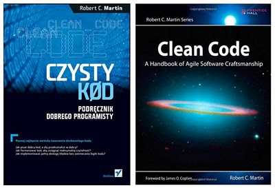

Długo czekałem na ten moment i oto jest: polskie wydanie książki Roberta C. Martina “Clean Code”. Możemy co prawda ponarzekać na czas oczekiwania na polskie tłumaczenie (ponad 1,5 roku), ale nie zmienia to faktu, że cieszy pojawienie się w naszym ojczystym języku pozycji, która jest ze wszystkich stron chwalona i polecana każdemu programiście.

{: .tip }
Dear Reader, this post is in my native language as it covers topic that makes sense only for people from Poland. But please feel free to browse my other articles as majority of them are written in English.

Na początku wrażenia estetyczne: okładka polskiego wydania jest dużo ładniejsza niż angielskiego. Nie zawsze podobały mi się okładki proponowane przez Helion w polskich wydaniach, ale tutaj akurat trafili bardzo dobrze i nowoczesny wygląd świetnie oddaje treść i tematykę publikacji.

Więcej o samej książce i jej treści można przeczytać na [blogu Pawła Zubkiewicza](http://pawelzubkiewicz.blogspot.com/2008/11/clean-code.html) oraz w [recenzjach na Amazon.com](http://www.amazon.com/Clean-Code-Handbook-Software-Craftsmanship/product-reviews/0132350882/ref=dp_top_cm_cr_acr_txt?ie=UTF8&showViewpoints=1). Chociaż książkę mam od prawie 2 tygodni, przeczytałem może 30%. Nie jest to książka lekka, trzeba się nad nią skoncentrować, by w pełni zrozumieć co chcieli przekazać nam autorzy. Sami zresztą piszą w niej:

> Bądź przygotowany na ciężką pracę przy czytaniu tej książki. To nie jest książka “łatwa i przyjemna”, którą można przeczytać w samolocie i skończyć przed lądowaniem. (…) Będziesz czytał kod – wiele kodu. Będziesz proszony o śledzenie zmian podczas rozdzielania modułów na części i ponownego ich składania. To będzie wymagało czasu i pracy.

Dlatego nie spieszę się i chłonę ją małymi porcjami. Gdy skończę to pewnie coś o tym skrobnę. A jakby mojego szczęścia było mało, to udało mi się wreszcie zdobyć egzemplarz książki [“Refaktoryzacja do wzorców projektowych”](http://helion.pl/ksiazki/refawp.htm). A za cynk, że ktoś ją właśnie wystawia na Allegro dziękuję Tomkowi Studzińskiemu 🙂

