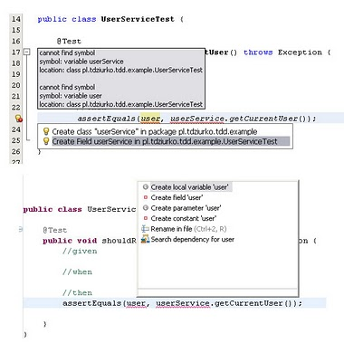

This week was very intensive in terms of education. First, a three-day training about Test-Driven Development at Pragmatists, then a presentation about Vaadin by [Bartek Kuczyński](http://koziolekweb.pl/) at Warsaw JUG meeting.

However, in this post I will focus on the most interesting thing, Test-Driven Development training and what I learnt there. The whole event lasted three days and in my opinion it was very effectively spent time. The only thing I didn’t like was a little too long theoretical introduction to the TDD and testing, but it is probably the feature of most trainings that the first chapter must be only about theory. Fortunately, later it started to be much, much more interesting and the workshops began. They consisted of pair programming, writing tests, refactoring to patterns, mocking with [Mockito](http://mockito.org/), everything I expected from this training when I had enrolled. And everything in the amount that helped me to understand the philosophy of software development with TDD on the practical side. Only a basic level, however, because to do it smoothly and quickly I have to spend a lot of time on Test-Driving and learning. But I did the first step.

Unfortunately at the beginning of this training it appeared that my lovely IDE (NetBeans) isn’t a natural-born IDE for TDD. And what’s the problem? NB isn’t smart enough when we are coding and trying to generate code by intention. For example, let’s compare the process of creating a testing method and how two IDEs: Eclipse and NetBeans are helping us in the following scenario:

```java
import org.junit.Test;
import static org.junit.Assert.*;

public class UserServiceTest {

    @Test
    public void shouldReturnCurrentUser() throws Exception {
        //given

        //when

        //then
        assertEquals(user, userService.getCurrentUser());
    }
}
```

After placing the cursor over the user variable and pressing Alt+Enter (NetBeans) or Ctrl+1 (Eclipse) we will see (Eclipse at the bottom, NetBeans fragment at the top):



Even at this early stage of comparison we can see that Eclipse gives us more flexibility in the process of generating code, it allows to create a local variable which will be our most frequent intention. NetBeans only tries to help us with proposing a new class field or even a new class which is a rather strange idea.

Ok, but let’s keep going. Suppose we have a yet undefined variable userService:

```java
import org.junit.Test;
import static org.junit.Assert.*;

public class UserServiceTest {

    @Test
    public void shouldReturnCurrentUser() throws Exception {
        //given

        //when

        //then
        assertEquals(user, userService.getCurrentUser());
    }
}
```

and we want to continue writing our test. Ctrl+Space on userService variable in NetBeans will give us only the option to generate UserService class. Whereas Eclipse will return the following options: generate class, generate interface, generate enum and additionally convert our class into two strange forms that I didn’t cover here 🙂 But in short, Eclipse gives us many more options to choose from. In our scenario we choose interface. If we choose class, Netbeans would create it in the same package (and we don’t want concrete classes lying next to test classes) and Eclipse would ask us where to place the new class.

Going further with our TDD we mock the service and create a default user. Now we need to add the method getCurrentUser().

```java
import org.junit.Test;
import static org.junit.Assert.*;
import static org.mockito.Mockito.*;

public class UserServiceTest {

    @Test
    public void shouldReturnCurrentUser() throws Exception {
        //given
        UserService userService = mock(UserService.class);
        User user = new User("John Doe");

        //when

        //then
        assertEquals(user, userService.getCurrentUser());
    }
}
```

And here let me introduce a nail in NetBeans’ coffin as a TDD-friendly IDE. It’s a missing ability to code by intention. When we place the cursor over the missing method and use hint short-cut NetBeans will generally fail and will not suggest any solution. And even a TDD newbie like me knows that similar situations in red-green-refactor cycle are very, very common. Of course we could help NetBeans with moving this method out of assertEquals:

```java
User userFromService = userService.getCurrentUser();
```

And only then we can see “create method” hint. In Eclipse we are not forced to use such tricks and it is possible to create a method from the inside of assertions right after we press Ctrl+1. Moreover comparing what both IDEs offer in automatic refactoring area gives us another reason to abandon NetBeans and use Eclipse in our everyday work because the amount of refactor options this IDE has is pretty impressive.

And what are the conclusions? Personally I think that Netbeans isn’t the best free IDE if we consider the Test-Driven Development approach. Eclipse is much better for this and if you are planning to learn TDD I can’t, in spite of my liking and good experience with NetBeans, suggest this IDE as the best choice.

