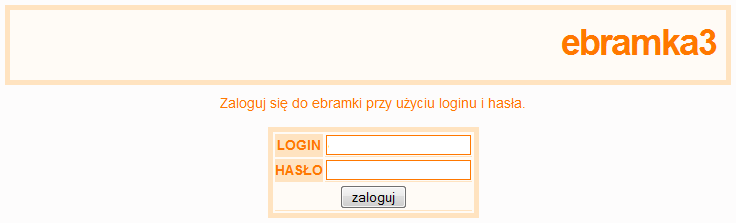
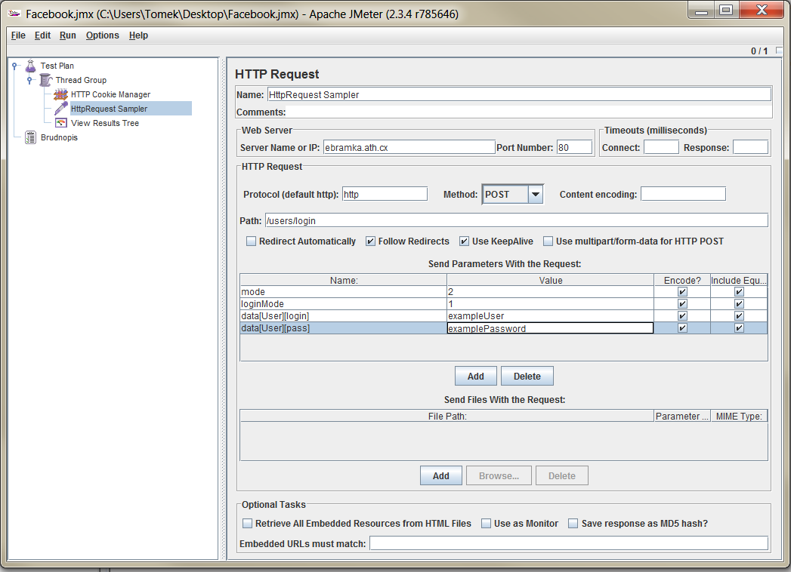
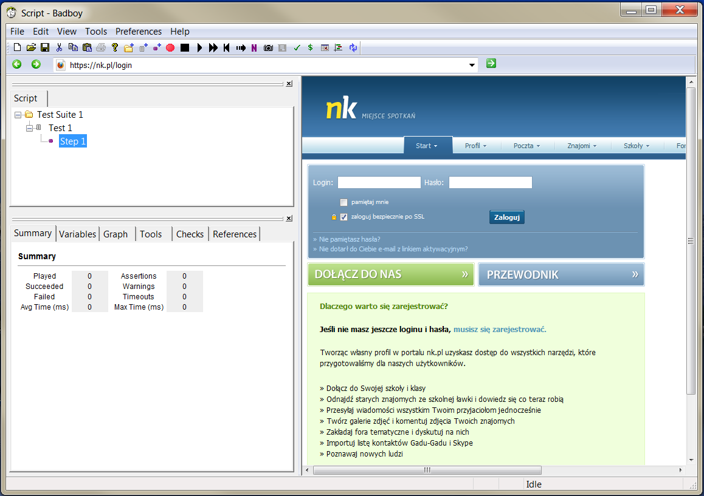

JMeter is a well-known tool for testing the performance of web applications, databases and many other things (check [project official site](http://jakarta.apache.org/jmeter/index.html) for more). Today I am going to show how to test a web application with JMeter when the user needs to be logged-in to take some actions (JMeter must fill and submit the login form first).

In my diploma thesis which involves comparison between Struts 2 and Wicket, I needed to run some tests on how fast both frameworks are. For this purpose I used the tool mentioned above. In this post I will show and describe how form submitting can be done from JMeter depending on application architecture and security level.

## Simple sending post-data to login form

**Example site:** [http://ebramka.ath.cx/](http://ebramka.ath.cx/) – Polish free sms gateway  
**Use case:** log in the user and then check if the main page rendered properly.

This one is pretty simple. No HTTPS protocol, no SSL, just pure post data sent to login form.

1. In JMeter create a new Thread Group (right click on your Test Plan, Add –> Thread Group).
2. Add a sampler which will send HTTP request to the server, right click on your Thread Group, Add –> Sampler –> HttpRequest.
3. Populate HttpRequest sampler with data from your web application (submit URL, all parameter names and values needed to submit the form). If you are not sure about some values use [Firebug](http://getfirebug.com/) (Firefox browser plugin) or something similar to analyze HTML form element and find all hidden and non-hidden inputs.

   

4. Most applications use cookies heavily so we need to add a module which manages them. Just right click on your Thread Group and Add –> Config Element –> Http Cookie Manager. Don’t forget to change cookie policy to use “compatibility” mode as I experienced some problems when a different mode was selected.
5. To check whether JMeter logged-in successfully to the web application we could use two modules: Response Assertion (Add –> Assertions –> Response Assertion) and configure what text should be found on the page after proper login (you must also add Listener –> Assertion Results) or just view response page after login using element View Results Tree (Add –> Listener –> View Results Tree) as I did in this example.

After taking all these steps press Ctrl-E (just in case, to clear previous results) then Ctrl-R (run test plan). After a few moments we could see that “Response data” tab in the View Results Tree contains the standard page after a successful login.

## Sending post-data to more complicated form using proxy

**Example site:** [GoldenLine](http://www.goldenline.pl/) – Polish service very similar to [LinkedIn](http://www.linkedin.com/)  
**Use case:** log in the user and then check if the main page rendered properly.

This one explains the situation when we want to test an application with a more complicated login form that we don’t know exactly how it works (we are only an application tester or the form is too complicated for full analysis with Firebug). In such a scenario proxy recording is a very useful JMeter feature.

1. Create a Thread Group in your test plan
2. Create an Http Proxy Server in your WorkBench, right click on it then Add –> Non-test elements –> Http Proxy Server.
3. Configure it: port 9090, Target controller “Test plan > Thread Group” (or any test plan and thread group name you chose). Optional: for HTTPS protocol select “Attempt Https spoofing” although it doesn’t work well for some cases I tested.
4. Configure your browser to use the just created proxy. In Firefox this should look like this Tools –> Options –> Advanced –> Network tab –> Settings. And there choose manual proxy server configuration, address: localhost, port: 9090 and if you are planning to record HTTPS select “use proxy for all other protocols”.
5. Return to JMeter and click the start button in the Http Proxy Server element.
6. Use your browser to navigate to the login form, fill it and submit.
7. Return to JMeter, stop proxy server and check recorded data in the Thread Group Element. Disable (or delete if you are sure) some redundant data (requests to images, statistics server, etc.).
8. Again, to check if it’s working add View Results Tree and run your plan (Ctrl-R).

Note 1: Sometimes you will have to add Http Cookie Manager and/or Http Header Manager to your thread group for the plan to start working as expected.  
Note 2: JMeter sometimes can’t handle HTTPS, SSL requests, more information about solutions [here](http://wiki.apache.org/jakarta-jmeter/JMeterAndHTTPS) and more about suggested program ([BadBoy](http://www.badboy.com.au/)) below.

## Sending post-data to secured, SSL login form

**Example site:** [Nasza-Klasa](http://www.nk.pl/) – Polish social service  
**Use case:** log in the user and then check if the main page rendered properly.

Sometimes the tested application uses encryption, SSL and HTTPS protocol. Lately JMeter gained a new feature called HTTPS spoofing and sometimes it will suffice but, as I experienced many problems with this function, I describe another suggested way of testing secure requests with BadBoy application which is a more advanced request recorder helping to test web applications (for more about BadBoy visit [online docs](http://www.badboysoftware.biz/docs/)).

1. Download and install BadBoy.
2. Run it.
3. In the main screen there is a browser-like area, and on the left you can see some menus and panels.

   

4. When the application opens, recording has already started, stop it (top menu, button on the right from red circle).
5. Use address field to type the address of the login page and press Enter.
6. Right click on the Step 1 in the left panel and press red “Record” button.
7. Fill and submit the login form.
8. Wait till the whole page is loaded then stop recording.
9. Use File menu to export recorded script to JMeter.
10. Open script with JMeter. At the moment I wrote this post there is a compatibility problem between BadBoy and the latest (2.4) version of JMeter ([forum thread](http://www.badboysoftware.biz/forum/viewtopic.php?p=8874)), so I used JMeter 2.3.4.
11. Check recorded data in the Thread Group Element. Disable (or delete if you are sure) some redundant data (requests to images, statistics server, etc.).
12. To check if it’s working add View Results Tree and run your plan (Ctrl-R).

That’s it. Using these three approaches you should be able to fill and test almost every form in your web application.

