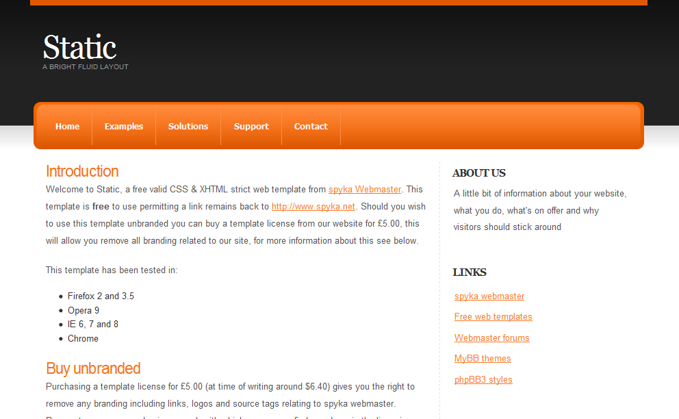
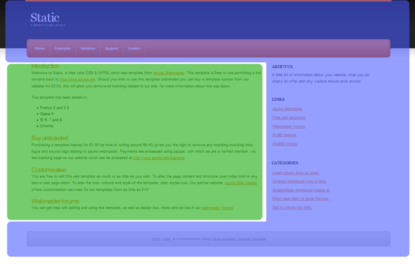
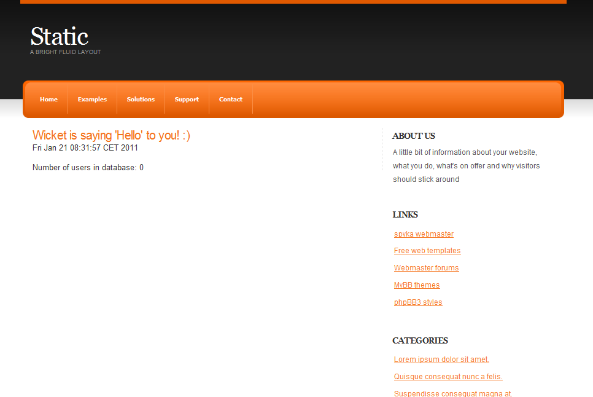
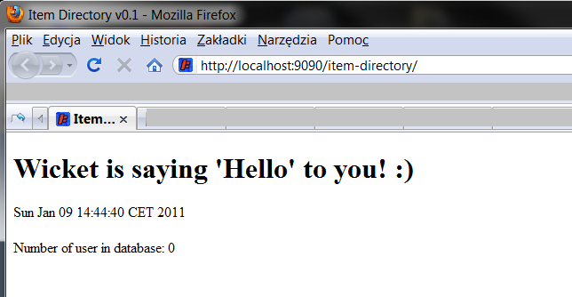
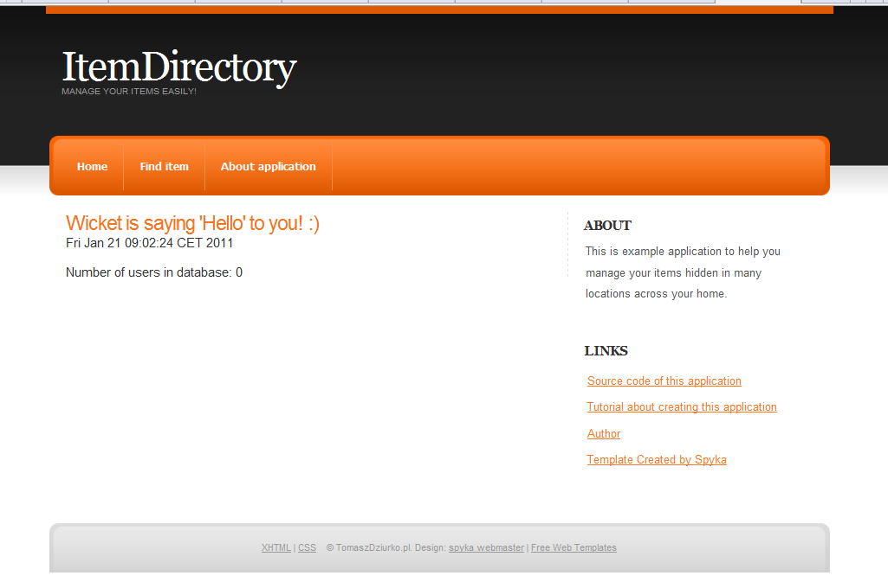
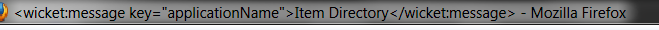

Hello everyone! In the [previous](/blog/wicket-tutorial-part-1-setting-up-project-with-spring-3-jpa-2-and-mysql) post we set up a base project using Wicket for our future development of ItemDirectory web application. That post, which was intended to be mainly about Wicket, surprisingly gathered some attention amongst Spring fans and was even mentioned in [the weekly summary at SpringSource.com](https://web.archive.org/web/20110906121925/http://www.springsource.org/node/2994).

Ok, enough about the past. Today we are going to add some nice common layout to ItemDirectory. Go go go! 🙂

## The layout

As winning “The best designed web application ever” award is not the purpose of this tutorial, I didn’t want to spend a lot of time on creating a beautiful layout. After a short search in Google results I found a nice free template which seems to suit our tutorial needs well:



The author of this free template is [Spyka](http://www.spyka.net/) and you can download it from [here](http://www.spyka.net/web-templates/static/). There you can find two other colour variations of our template (if you don’t like orange 🙂) and many others to choose from if you want to choose completely different one.

## Adding template to Wicket application

After downloading the template we need to take the following steps in order to make ItemDirectory use it:

1. Copy styles.css file and images directory into src/main/webapp folder.
2. Copy the content of index.html and paste it into BasePage.html.
3. Modify BasePage.html a little:

Because we are planning to use a consistent layout across the whole application we will put common elements (marked as **blue, transparent area** on the image below) in BasePage.html and elements changing in each page (marked as **green area**) in corresponding page class. Using this technique will allow us to place logic responsible for repeating layout things in one place (BasePage class) and logic responsible for generating page-specific data in each page class inheriting from BasePage.



So after pasting complete index.html contents into BasePage.html we delete the part responsible for the green area (everything in `<div class="content">` tag) and replace it with marker `<wicket:child/>` which will inform Wicket that filling this area is a role of the inheriting class and not a BasePage class itself. After these modifications the changed part of the HTML file should look like presented below:

```html
<div class="content">
    <!-- CONTENT -->

    <wicket:child/>

    <!-- END CONTENT -->
</div>
```

And the last modification to prevent our IDE from marking wicket:id elements as invalid: proper XML namespace declared in HTML file. Just make sure that the beginning of your BasePage.html looks similar to this:

```html
<!DOCTYPE html PUBLIC "-//W3C//DTD XHTML 1.0 Strict//EN"
    "http://www.w3.org/TR/xhtml1/DTD/xhtml1-strict.dtd">
<html xmlns="http://www.w3.org/1999/xhtml"
    xmlns:wicket="http://wicket.apache.org/dtds.data/wicket-xhtml1.4-strict.dtd"
>
```

Declaration below informs that we are using Wicket namespace.

```html
xmlns:wicket="http://wicket.apache.org/dtds.data/wicket-xhtml1.4-strict.dtd"
```

And coming back to our steps…

4. Modify HomePage.class
{: start="4"}

If you want to be able to view full pages with an external HTML editor you should paste complete index.html contents into HomePage.html and remember to place old content between `<div class="content">` like in the listing below:

```html
<div class="content">
    <!-- CONTENT -->
        <wicket:extend>
        <h3 wicket:id="helloLabel"></h3>
        <span wicket:id="currentTime"></span>
        <br/>
        <br/>
        Number of users in database: <span wicket:id="numberOfUsers"/>
        </wicket:extend>
    <!-- END CONTENT -->
</div>
```

You don’t have to worry about content outside wicket:extend element as it will be ignored by the framework (except some special cases marked with other wicket tags).

OK, we are done with template adding. If you want to view the code, it is available in the [GitHub repository](https://github.com/tdziurko/item-directory-with-wicket/tree/c9025bfb2f3fdfe0932be0805201133be39605ce). Result should be like that:



Isn’t it much better than the previous one? 🙂



### Cleaning out the layout

Now we have a pretty good layout, but we need to remove some elements that aren’t needed in our application. And because the features planned until now are:

- listing items with pageable view
- adding/editing existing items
- viewing selected item details
- searching by advanced criteria

Note that these are only plans, and can be changed, even You can change the list of features with comments and suggestions!

So currently we don’t need most of these links in the layout. I leave empty places to (maybe) fill them with additional requested features in the future. After cleaning the main page looks like that:



List of changes (complete source code can be viewed [here](https://github.com/tdziurko/item-directory-with-wicket/tree/c9025bfb2f3fdfe0932be0805201133be39605ce)):

- removed some links from top panel, renamed some of them
- removed some links from side panel
- added links to sources, to this tutorial, etc. on the side panel
- changed title and header

Ok, now we have got a cleaned look ready to start playing with Wicket again 🙂

## Adding custom titles

As we plan to make our application available to users across the globe, we will add internationalization in the future, we would like to have one place to define application name, heading, etc. And Wicket makes it very easy with properties file and wicket:key element:

First, we create file Application.properties next to Application.java file in pl.tomaszdziurko.itemdirectory.web package with the following key-value pairs:

```properties
applicationName = Item Directory
applicationHeader = Manage your items easily!
```

Next in BasePage.html replace application name and header text and page title with Wicket element `<wicket:message key="keyName"/>`. This element will tell Wicket to load text from properties file (more about this [here](https://cwiki.apache.org/confluence/display/WICKET/Wicket%27s+XHTML+tags) in Wicket Wiki)

```html
(...)
  <title><wicket:message key="applicationName"/></title>
  <link rel="stylesheet" href="styles.css" type="text/css" />
  </head>
  <body>

  <div class="header-wrapper">
    <div class="header pagewidth">
      <!-- TITLE -->
      <h1><a href="#"><wicket:message key="applicationName"/></a></h1>
      <h2><wicket:message key="applicationHeader"/></h2>
      <!-- END TITLE -->
    </div>
  </div>
  (...)
```

When we reload the page after Jetty noticed changes in the code, we could see the page looking exactly the same as before adding properties file so everything seems to work correctly. But when we look at the title bar in the web browser:



Oh no! – you might think – I screwed something up! But don’t worry, it’s not a bug, it’s a feature 🙂 Do you remember the fragment of Application.java class?

```java
@Override
  protected void init() {
      super.init();
      // (...)

      if (getConfigurationType().equals(WebApplication.DEPLOYMENT)) {
          getMarkupSettings().setStripWicketTags(true);
          getMarkupSettings().setStripComments(true);
          getMarkupSettings().setCompressWhitespace(true);
      }

  }
```

Default Wicket behaviour is to render its tags, just to make it easier to debug and develop the application. But in this code listing we said that if we deploy our application to the production, all tags should be stripped: _setStripWicketTags(true)_. So if you move this method out of the if brackets we will see that now our title renders correctly.

And what now? While developing the application, we will leave this ugly title for now because we might want to look into rendered HTML page source to check something connected with Wicket tags and if they are stripped we won’t see anything useful 🙂 And after production deployment, title will start looking as we planned.

Complete source code is available in the [GitHub repository](https://github.com/tdziurko/item-directory-with-wicket/tree/c9025bfb2f3fdfe0932be0805201133be39605ce).

## Summary

Ok, that’s all for today. I planned to add the first form to the project but this post is long enough without it, so Wicket form will be the main topic of the next post. Thank you for your patience. All comments and suggestions are welcome!
