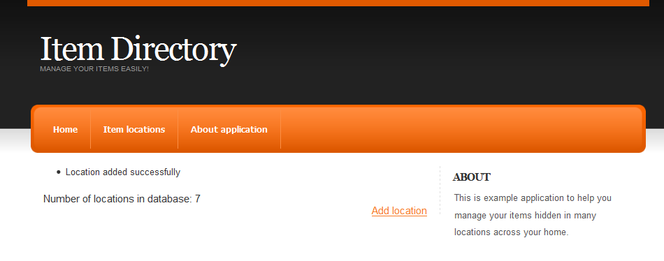

Hello Visitor 🙂 In previous posts we created a [base project](/blog/wicket-tutorial-part-1-setting-up-project-with-spring-3-jpa-2-and-mysql) and added [common layout](/blog/wicket-tutorial-part-2-adding-common-layout-to-the-project) to ItemDirectory Wicket application. Today we are going to add the first form to allow users to insert some data into our application.

As the main feature of ItemDirectory is to manage information where items (books, movies, music, postage stamps) are stored in our home/work, the first data we need to know are locations where we actually can store those things. So we start with adding a table, an entity and a form to manage locations of our precious items.

### Database, entity and DAO

The first thing we need is a locations table in the database and an entity mapping class:

Create table script listing:

```sql
create table locations (
  id bigint(20) not null auto_increment,
  name varchar(255) not null,
        PRIMARY KEY (id),
  UNIQUE KEY unique_name (name)
);
```

Entity class listing:

```java
@javax.persistence.Entity
@Table(name = "locations")
public class Location extends AbstractEntity {
    @Id
    @GeneratedValue(strategy = GenerationType.IDENTITY)
    private Long id;
   @Column(length=255, nullable=false)
    private String name;
        protected Location() {
      super();
  }
  public Location(String name) {
      super();
      this.name = name;
  }
  // getters, setters omitted
}
```

As you can see, Location class is very simple: only one field, but the only thing we want at the moment from this entity is a name describing where an item is stored. Is it “Bookcase in living room, second drawer from the top” or “Cabinet in the saloon, top bookshelf”.

After creating the table and entity we have to prepare DAO and service layer. As it is not closely connected with Wicket I will skip this part, but those more interested in it can find details in [this changeset](https://bitbucket.org/tdziurko/item-directory/changeset/f4daa5e8b912) in the repository.

## Add Location Wicket Pages

We start with LocationsPage which will, in the future, show listing with all locations available. For now, the page will display the number of locations in the database (very similar to users counter in the HomePage) just to show that creating new location was successful.

Listings of LocationsPage java and HTML files:

```html
<!DOCTYPE html PUBLIC "-//W3C//DTD XHTML 1.0 Strict//EN" "http://www.w3.org/TR/xhtml1/DTD/xhtml1-strict.dtd">
<html xmlns="http://www.w3.org/1999/xhtml" xml:lang="en" lang="en"
  xmlns:wicket="http://wicket.apache.org/dtds.data/wicket-xhtml1.4-strict.dtd">
<head>
</head>
<body>
  <wicket:extend>
      <div>
          Number of locations in database: <span wicket:id="numberOfLocations"/>
      </div>
      <div style="float: right;">
          <a href="#" wicket:id="addLocationPageLink">Add location</a>
      </div>
  </wicket:extend>
</body>
</html>
```

```java
public class LocationsPage extends BasePage {
  @SpringBean
  private LocationService locationService;
  public LocationsPage() {
      initGui();
  }
  private void initGui() {
      add(new Label("numberOfLocations", locationService.size() + ""));
      add(new Link<BasePage>("addLocationPageLink") {
          @Override
          public void onClick() {
              setResponsePage(new AddLocationPage());
          }
      });
  }
}
```

If you were cautious enough you probably noticed a link I didn’t mention earlier. It’s a simple link redirecting the user to AddLocationPage when clicked (see overridden method onClick()).

Next we add a link to LocationsPage in the BasePage to appear on the topbar. In BasePage.html we add a Wicket placeholder for this link:

```html
 <div class="nav">
      <ul>
          <!-- MENU -->
          <li><a href="" wicket:id="homePageLink">Home</a></li>
          <li><a href="" wicket:id="locationsPageLink">Item locations</a></li>
          <li><a href="#">About application</a></li>
          <!-- END MENU -->
      </ul>
  </div>
```

and in the corresponding Java class add a line:

```java
private void addTopMenuLinks() {
      add(new BookmarkablePageLink<BasePage>("homePageLink", Application.get().getHomePage()));
      add(new BookmarkablePageLink<BasePage>("locationsPageLink", LocationsPage.class));   // this one is new : )
}
```

Everything seems to be ok, you can do mvn jetty:run to see the results, but one thing could be easily improved, the URL address of LocationsPage. Instead of ugly one:

[http://localhost:9090/item-directory/?wicket:bookmarkablePage=:pl.tomaszdziurko.itemdirectory.web.view.locations.LocationsPage](http://localhost:9090/item-directory/?wicket:bookmarkablePage=:pl.tomaszdziurko.itemdirectory.web.view.locations.LocationsPage)

after adding one line to Application class:

```java
private void mountBookmarkablePages() {
      mountBookmarkablePage("locations", LocationsPage.class);
}
```

we configure Wicket to:

- redirect all requests coming from [http://localhost:9090/item-directory/locations](http://localhost:9090/item-directory/locations) url to LocationsPage
- render all bookmarkable links to this page as clear and nice /locations one.

Easy! 🙂

Changes from this part can be viewed in these two changesets: [[1]](https://bitbucket.org/tdziurko/item-directory/changeset/cfca7dbd3ad2), [[2]](https://bitbucket.org/tdziurko/item-directory/changeset/9744ed2ec11c)

## Add location form

Now it’s time to start with the main part of this post: html form to add a new location. The first step is to add placeholders in AddLocationsPage.html:

```html
<!DOCTYPE html PUBLIC "-//W3C//DTD XHTML 1.0 Strict//EN" "http://www.w3.org/TR/xhtml1/DTD/xhtml1-strict.dtd">
<html xmlns="http://www.w3.org/1999/xhtml" xml:lang="en" lang="en"
  xmlns:wicket="http://wicket.apache.org/dtds.data/wicket-xhtml1.4-strict.dtd">
<head>
  <wicket:head>
      <title>Item Directory v0.1</title>
    </wicket:head>
</head>
<body>
  <wicket:extend>
      <h3>
          Add location
      </h3>
      <br/>
          <form action="" wicket:id="addLocationForm">
              <label for="name" wicket:id="nameLabel">Location name</label> <input type="text" id="name" wicket:id="name"/>
              <br/>
              <input type="submit" value="Save" class="formbutton" name="save" wicket:id="submitButton"/>
          </form>
  </wicket:extend>
</body>
</html>
```

The second step is to create components in Java class:

```java
public class AddLocationPage extends BasePage {
  private String name;
  public AddLocationPage() {
      initGui();
  }
  private void initGui() {
      Form<AddLocationPage> addLocationForm = new Form<AddLocationPage>("addLocationForm",
              new CompoundPropertyModel<AddLocationPage>(this));  // (1)
      add(addLocationForm);
      Label nameLabel = new Label("nameLabel", "Location name");    // (2)
      addLocationForm.add(nameLabel);
      TextField<String> nameField = new TextField<String>("name");   // (3)
      addLocationForm.add(nameField);
      Button submitButton = new Button("submitButton") {          // (4)
          @Override
          public void onSubmit() {
              System.out.println("OnSubmit, name = " + name);
          }
      };
      addLocationForm.add(submitButton);
  }
}
```

The HTML file is rather self-explanatory: a simple form with one input field and a submit button. But the java page class needs a more elaborate explanation:

In **(1)** we create a Wicket form with a model to gather data from the user. We use [CompoundPropertyModel](http://wicket.apache.org/apidocs/1.4/org/apache/wicket/model/CompoundPropertyModel.html) which automatically connects components with properties of model object with the same id/name. In our page model object is AddLocationPage itself and its _name_ field (with usage of Compound model) works as a model for TextField component with id _name_.

> Concept of models is one of the most important elements of Wicket and you should understand what models do and how they work. In this tutorial I am concentrating on practical usage of Wicket, so theory isn’t covered in great detail.  
> Although you can read more about models on two [[1]](https://cwiki.apache.org/WICKET/working-with-wicket-models.html) and [[2]](https://cwiki.apache.org/WICKET/more-on-models.html) Wiki pages and generally in two presentations by Mystic Coders. Links to them can be found in the “Tutorial, guides” section in Wicket – useful links post

In **(2)**, **(3)** and **(4)** we create and add to our form: label for input field, input field (note that it’s called _name_, as property in page class) and submit button with overridden onSubmit method in which we place save logic.

This part of the tutorial can be viewed in [this changeset](https://bitbucket.org/tdziurko/item-directory/changeset/7b5ed603b8e4).

## Validating and saving data

After we created the form the next obvious step is to add a call to LocationService.save method. But before that we must validate user input to check if it is correct and won’t blow our application out 🙂 You can easily do it with leaving name empty and submitting a form: an exception deep from Hibernate internals in your face 🙂

So we must add some validators first:

1. Name field should be required
2. Name field length should be between 4 and 255.
3. There should be only one location with the same name (check unique constraint on [locations table](https://bitbucket.org/tdziurko/item-directory/src/7b5ed603b8e4/itemdirectory.domain/src/main/resources/sql/003.locations_table.sql)).

**Required text field**

There are two ways to make a field required: you can call _TextField.setRequired(true)_ or you can replace [TextField](http://wicket.apache.org/apidocs/1.4/org/apache/wicket/markup/html/form/TextField.html) component with [RequiredTextField](http://wicket.apache.org/apidocs/1.4/org/apache/wicket/markup/html/form/RequiredTextField.html) one. In our application I chose the latter.

**String length validation**

Adding length validation in Wicket is very, very easy. We use [StringValidator](http://wicket.apache.org/apidocs/1.4/org/apache/wicket/validation/validator/StringValidator.html) and one of its nested classes: ExactLengthValidator, LengthBetweenValidator, MaximumLengthValidator or MinimumLengthValidator. In our case the java code looks like that:

```java
// (...), final constants for lengths are defined here

RequiredTextField<String> nameField = new RequiredTextField<String>("name");
nameField.add(LengthBetweenValidator.lengthBetween(MIN_LOCATION_NAME_LENGTH, MAX_LOCATION_NAME_LENGTH));
addLocationForm.add(nameField);
```

**Unique location name validator**

This validator needs a longer explanation as it will be our first custom validator and it will be covered in the next post as I am now going to talk about showing error messages and saving location in the database to finish with almost perfectly working (except non-unique names) form in ItemDirectory web application.

## Show user what’s wrong or what’s ok

Now, when we have some validation it would be cool to be able to tell the user what he did wrong or when his action performed successfully. In Wicket there is a component dedicated to showing feedback to the user: [FeedbackPanel](http://wicket.apache.org/apidocs/1.4/org/apache/wicket/markup/html/panel/FeedbackPanel.html). And as it will be potentially used in every page we will add it in BasePage class:

```java
public abstract class BasePage extends WebPage {

// (...)

  private void initGui() {
      addTopMenuLinks();
      add(new FeedbackPanel("feedbackPanel"));
  }
}
```

```html
 <div class="content">
      <!-- CONTENT -->

      <div wicket:id="feedbackPanel"></div>

      <wicket:child/>

      <!-- END CONTENT -->

 </div>
```

And how is it working? When validation fails on any validator, it adds a message to the feedback panel and rerenders the page. Then, on rerender, messages are flushed and showed to the user on Error level (there are three levels: Info, Warn, Error which render in different css styles so their look can be customized). Ok, so far so good but what if we want to add such info manually? No problem, we will do this when a successful save of Location object occurs. In this step we also add a call to LocationService.save method to actually save a new Location object in the database.

```java
public class AddLocationPage extends BasePage {

  private static final int MIN_LOCATION_NAME_LENGTH = 5;
  private static final int MAX_LOCATION_NAME_LENGTH = 255;

  @SpringBean
  private LocationService locationService;

  private String name;

  public AddLocationPage() {
      initGui();
  }

  private void initGui() {

      Form<AddLocationPage> addLocationForm = new Form<AddLocationPage>("addLocationForm",
              new CompoundPropertyModel<AddLocationPage>(this));
      add(addLocationForm);

      Label nameLabel = new Label("nameLabel", "Location name");
      addLocationForm.add(nameLabel);

      RequiredTextField<String> nameField = new RequiredTextField<String>("name");
      nameField.add(LengthBetweenValidator.lengthBetween(MIN_LOCATION_NAME_LENGTH, MAX_LOCATION_NAME_LENGTH));
      addLocationForm.add(nameField);

      Button submitButton = new Button("submitButton") {
          @Override
          public void onSubmit() {
              Location location = new Location(name);
              locationService.save(location);

              getSession().info("Location added successfully");
              setResponsePage(LocationsPage.class);
          }
      };
      addLocationForm.add(submitButton);
  }
}
```

Every Wicket component has three methods info(String message), warn(…), error(…) which add a feedback message for a component and they are very useful for validating data, etc. However, if we want to redirect the user to another page and show message there, we must use another way of adding feedback messages, based on user session and not on current component as component messages won’t be rendered after redirect to other page. That’s why we use getSession().info(…);  
If you try with only info(…) you will get a warning in the log:

```text
WARN  - WebSession                 - Component-targetted feedback message was left unrendered. This
could be because you are missing a FeedbackPanel on the page.  Message: [FeedbackMessage message = "
Location added successfully", reporter = submitButton, level = INFO]
```

And after this we will see that everything is working as expected:



## Summary

Ok, we reached the end of this post. We now have a working Wicket form in our application. In the next episode we will create a custom validator to prevent adding non-unique location names. Of course as always you can download the latest source code from [here](https://bitbucket.org/tdziurko/item-directory/src). Hope you will be here for the next part of Wicket tutorial 🙂
