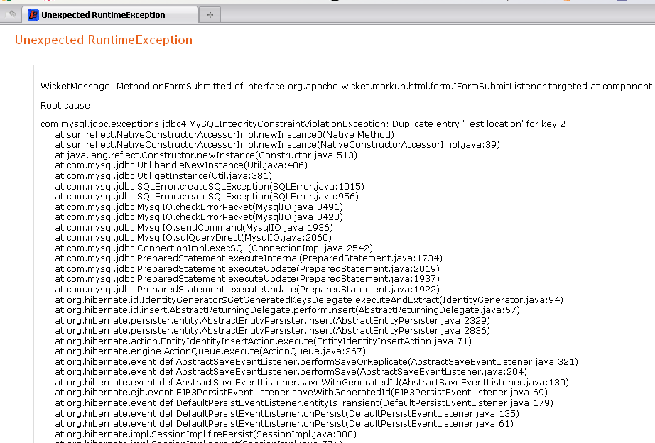
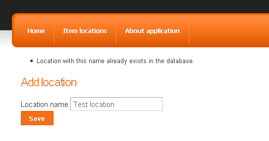

Welcome back to our [Wicket tutorial](/blog/wicket-tutorial-series-building-web-application-scratch) series! 🙂 As I mentioned in the [previous post](/blog/wicket-tutorial-part-3-form-application), today we will concentrate on building a validator stopping the user from adding an item location with a non-unique name. At first we will start with a non-generic but working validator and then we will try to make it as flexible as possible. Ok, so let’s write some code!

## Problem

As you might remember, currently we have a Wicket form with basic validation checking the existence of the name field and whether its length is in proper range or not:

```java
Form<AddLocationPage> addLocationForm = new Form<AddLocationPage>("addLocationForm",
          new CompoundPropertyModel<AddLocationPage>(this));
  add(addLocationForm);

  Label nameLabel = new Label("nameLabel", "Location name");
  addLocationForm.add(nameLabel);

  RequiredTextField<String> nameField = new RequiredTextField<String>("name");
  nameField.add(LengthBetweenValidator.lengthBetween(MIN_LOCATION_NAME_LENGTH, MAX_LOCATION_NAME_LENGTH));
  addLocationForm.add(nameField);

  Button submitButton = new Button("submitButton") {
      @Override
      public void onSubmit() {
          Location location = new Location(name);
          locationService.save(location);

          getSession().info("Location added successfully");
          setResponsePage(LocationsPage.class);
      }
  };
  addLocationForm.add(submitButton);
```

But with a unique constraint on the name field in the locations table in our database, trying to insert a new location with a name equal to another existing location will, as expected, end with such error:



## Solution

The easiest way to prevent the user from causing such exceptions is to create a custom validator checking if such a location is already in our database. And as we will be validating String input we will use [StringValidator](https://web.archive.org/web/20130912081425/http://wicket.apache.org/apidocs/1.4/index.html?org/apache/wicket/validation/validator/StringValidator.html) class as a base class for our own validator called UniqueLocationNameValidator:

```java
public class UniqueLocationNameValidator extends StringValidator {

  @SpringBean
  private LocationService locationService;    // (1)

  private long locationIdToIgnore;            // (2)

  public UniqueLocationNameValidator(long locationIdToIgnore) {
      this();
      this.locationIdToIgnore = locationIdToIgnore;
  }

  public UniqueLocationNameValidator() {
      InjectorHolder.getInjector().inject(this);            // (3)
  }

  @Override
  protected void onValidate(IValidatable<String> validatable) {      // (4)
      Location location = locationService.findByName(validatable.getValue());

      if(location != null && location.getId().longValue() != locationIdToIgnore) {
          error(validatable);
      }
  }
}
```

So starting from the beginning of the listing above:

1. As we will need a service object to communicate with the locations database table, we are injecting LocationService
2. In the future, we will also use this validator to validate locations while editing them. The Id of the currently edited object will prevent the validator from firing an error when the found object has the same Id as edited one. Currently we will not use this feature.
3. @SpringBean annotation is working without any other effort only in Wicket [Component](https://web.archive.org/web/20140210115127/http://wicket.apache.org/apidocs/1.4/index.html?org/apache/wicket/Component.html) class and its children so when we want to use it in a different class, we have to tell Wicket to auto inject beans here.
4. onValidate() method is the core of the validating class. We try to search for a location with the same name as provided by the user and if application finds one and its Id is different from edited entity object, we fire an error message.

The error message can be defined in a properties file and, as we will probably use our validator in more than one place, we add it in Application.properties file:

```properties
applicationName = Item Directory
applicationHeader = Manage your items easily!
UniqueLocationNameValidator = Location with this name already exists in the database.
```

Of course we have to create a findByName() method in LocationService. In our layered architecture (which currently could be considered as overkill but in a larger project it really pays off) the service calls a dao method, so the logic for finding a location by name is in LocationDaoImpl class:

```java
public Location findByName(String locationName) {
      Query findByNameQuery = entityManager.createQuery("from " + getClazz().getSimpleName()
                    + " entity where entity.name = :aName");
      findByNameQuery.setParameter("aName", locationName);

      return (Location) findByNameQuery.getSingleResult();

  }
```

When we have our validator and DAO logic ready, we can modify the Wicket form to make it complete and ready for the production. To use a custom validator we simply create such an object and add it to the field we want to validate (fragment of AddLocationPage class below):

```java
UniqueLocationNameValidator locationNameValidator = new UniqueLocationNameValidator();
nameField.add(locationNameValidator);
```

And when we submit this form with existing location name we will see feedback message showing that validation is working:



Ok, this is a good moment for a short break. If you want to see complete changes we made so far in the code, please refer to the [GitHub repository](https://github.com/tdziurko/item-directory-with-wicket/tree/c9025bfb2f3fdfe0932be0805201133be39605ce). And now at this point we could end this post, as we reached our goal for today: validation is complete and running. But there is one problem…

## We are lazy 🙂

Yeah, we are lazy, really lazy developers and we hate breaking the [DRY](http://pl.wikipedia.org/wiki/DRY) rule, so instead of writing N unique entity validators for each time we need one, we will write a generic one. But more about this in the next (almost ready) post 🙂

Thank you for reading and see you next time. Please don’t forget to leave your feedback in the comments.

