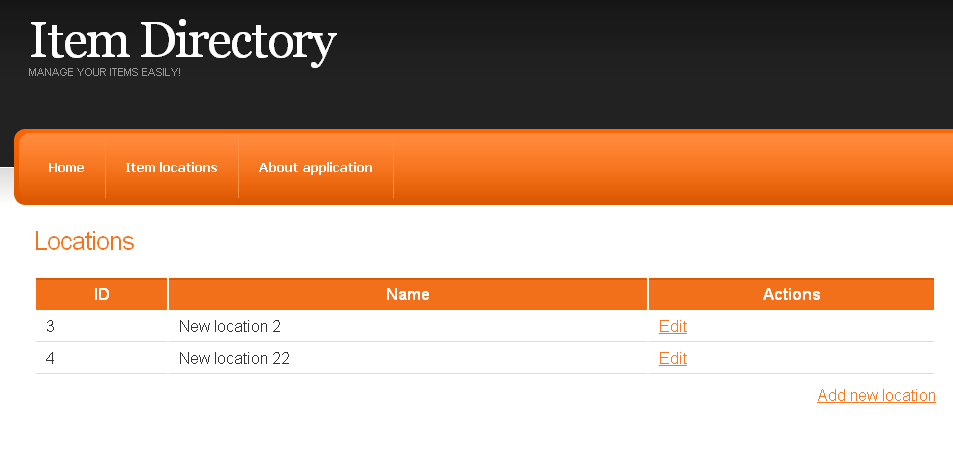
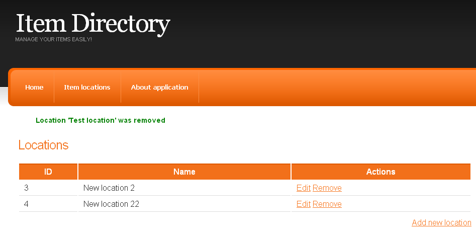

Welcome back to our practical Wicket tutorial series. I apologize for the long break after the last post (shame on me as it was published more than 1,5 months ago) but I had many unplanned things with higher priority: Wicket demo application on [33rdDegree](http://33degree.org/talks.html#BOFWebFrameworks) conference to prepare, the conference itself and the most time-consuming one, I damaged a knee ligament during a football match and after that every day for three weeks I was driving to the hospital for rehabilitation so the day became too short to write something here. But now everything seems to be ok and I have some spare time to continue Wicket tutorial subject.

Today we will add two new features: editing and removing locations from our application. Currently we don’t have any items connected with locations so deleting shouldn’t be too complicated. Later on, when we add some items, we will have to rework this functionality but now it shouldn’t bother us too much.

## Editing locations

To edit a location we should first add a link to the LocationsPage redirecting the user to the edit page:

```html
<table>
    <tr>
        <th>ID</th><th>Name</th><th>Actions</th> <!-- new header column -->
    </tr>
    <span wicket:id="locations">
        <tr>
      <td><span wicket:id="id"></span></td>
      <td><span wicket:id="name"></span></td>
            <td><a href wicket:id="editLocationLink">Edit</a></td> <!-- this is new -->
        </tr>
    </span>
</table>
```

In the corresponding Java class we add a link to the edit page:

```java
 ListView<Location> locations = new ListView<Location>("locations", createModelForLocations()) {
   @Override
   protected void populateItem(final ListItem<Location> item) {
     item.add(new Label("id", new PropertyModel<Location>(item.getModel(), "id")));
     item.add(new Label("name", new PropertyModel<Location>(item.getModel(), "name")));

     Link<BasePage> editLocationLink = new Link<BasePage>("editLocationLink") {
       @Override
       public void onClick() {
         setResponsePage(new AddEditLocationPage(item.getModelObject().getId()));
       }
     };

     item.add(editLocationLink);
   }
 };
```

A careful reader might notice that we have a new class here, AddEditLocationPage. But it’s just the old AddLocationPage renamed after some refactoring to reuse it for both creating new and editing existing locations. As in the code listing above, we are passing the Id of the location to the constructor to inform which object we are going to edit.

## Refactoring AddLocationPage to AddEditLocationPage

Apart from renaming both Java and HTML files we have to introduce some major changes to this Java class.

First we add a constructor taking id as a parameter:

```java
public AddEditLocationPage(Long locationId) {
  Location location = locationService.findById(locationId);
  setDefaultModel(new Model<Location>(location));
  initGui();
}
```

_setDefaultModel_ will enable other components from the page to use the loaded location as a source of rendered data. After this, to be consistent we change the constructor for new locations too:

```java
public AddEditLocationPage() {
  setDefaultModel(new Model<Location>(new Location()));
  initGui();
}
```

After these changes initGui() method needs some tweaks because it should use data from the default page model and not from the String name field:

```java
private void initGui() {
 Form<Location> addLocationForm = new Form<Location>("addLocationForm",
   new CompoundPropertyModel<Location>(getDefaultModel()));  // (1)

 add(addLocationForm);

 Label nameLabel = new Label("nameLabel", "Location name");
 addLocationForm.add(nameLabel);

 addLocationForm.add(createLabelFieldWithValidation()); // (2)

 Button submitButton = new Button("submitButton") {
   @Override
   public void onSubmit() {
     Location location = getLocationFromPageModel(); // (3)

     if(location.isNew()) {              // (4)
       locationService.save(location);
       getSession().info("Location added successfully");
       }
     else {
       locationService.update(location);
       getSession().info("Location updated successfully");
     }

     setResponsePage(LocationsPage.class);
   }
 };
 addLocationForm.add(submitButton);
}

private RequiredTextField<String> createLabelFieldWithValidation() {     // (5)
 RequiredTextField<String> nameField = new RequiredTextField<String>("name");
 nameField.setLabel(new Model<String>("Name"));
 nameField.add(LengthBetweenValidator.lengthBetween(MIN_LOCATION_NAME_LENGTH, MAX_LOCATION_NAME_LENGTH));

 nameField.add(createUniqueLocationNameValidator());   // (6)

 return nameField;
}

private UniqueEntityValidator<String> createUniqueLocationNameValidator() {    // (7)
 UniqueEntityValidator<String> locationNameValidator = null;
 if(getLocationFromPageModel().isNew()) {
   locationNameValidator = new UniqueEntityValidator<String>(locationDao, "name");
 }
 else {
   locationNameValidator = new UniqueEntityValidator<String>(locationDao, getLocationFromPageModel().getId(), "name");  // (8)
 }

 return locationNameValidator;
}

@SuppressWarnings("unchecked")
private Location getLocationFromPageModel() {       // (9)
  return (Location) getDefaultModel().getObject();
}
```

**This code listing needs some explanation:**

In **(1)** we are changing the model of Form to use the default model from the parent page so we could load data from existing or new (just created) location.

Then in **(2)** the extracted method createLabelFieldWithValidation() is invoked and inside it **(5)** the input field component is created and (more important) a proper validator is assigned to this input field **(6)**.

The way the validator is created **(7)** depends on whether we edit an existing location and our unique name check should not create an error if the same location with the same name is found **(8)** or we just create a new location and any existing location with the same name should prevent application from creating a new one. In this method we use helper method **(9)** extracting Location from page model.

Ok, that’s everything we have to do to add the edit feature. We now can edit and add new locations as shown on the screen shot below.



## Removing locations

To start adding this feature we place another link in the LocationsPage HTML file (next to the Edit one) and add a link to the Java class:

```java
ListView<Location> locations = new ListView<Location>("locations", createModelForLocations()) {
  @Override
    protected void populateItem(final ListItem<Location> item) {
    item.add(new Label("id", new PropertyModel<Location>(item.getModel(), "id")));
    item.add(new Label("name", new PropertyModel<Location>(item.getModel(), "name")));

    Link<BasePage> editLocationLink = new Link<BasePage>("editLocationLink") {
      @Override
      public void onClick() {
        setResponsePage(new AddEditLocationPage(item.getModelObject().getId()));
      }
    };

    item.add(editLocationLink);
    item.add(new RemoveLocationLink("removeLocationLink", item.getModelObject())); // new remove link component
  }
};
```

And because we know that in the future the logic for removing a location will be more complicated, it will be easier to change it if we create the remove location link as a separate class:

```java
public class RemoveLocationLink extends Link<Void> {

  @SpringBean
  LocationService locationService;

  private final Location location;

  public RemoveLocationLink(String componentId, Location location) {
    super(componentId);
    this.location = location;
  }

  @Override
  public void onClick() {
    locationService.remove(location);

    getSession().info("Location '" + location.getName() + "' was removed");
    setResponsePage(LocationsPage.class);
  }

}
```

We are almost done. The last thing we need to change is the method in the service class responsible for removing entity. Without this change we will be trying to delete a detached entity so we should use removeSafely() method instead of remove():

```java
public class LocationServiceImpl implements LocationService {

 @Autowired
 private LocationDao locationDao;

 // (..)

 public void remove(Location location) {
   locationDao.removeSafely(location);
 }

 // (...)
}
```

 which is implemented in AbstractDAO class:

```java
public void removeSafely(EntityClass entity) {
  getEntityManager().remove(
    getEntityManager().getReference(getClazz(), entity.getId()));
}
```

After this small change the application is ready for tests and we can check that everything works just fine.



## Summary

That’s all for today. Latest source code is available [here](https://bitbucket.org/tdziurko/item-directory/src) next to both changesets to view and analyse [(editing location](https://bitbucket.org/tdziurko/item-directory/changeset/45020512e60b) and [removing location](https://bitbucket.org/tdziurko/item-directory/changeset/9e6a2c58e4e7)). Thank you for your time and as always, any comments, suggestions, etc are welcome 🙂

Next episode will be released in a week or two maximum, so stay tuned!
