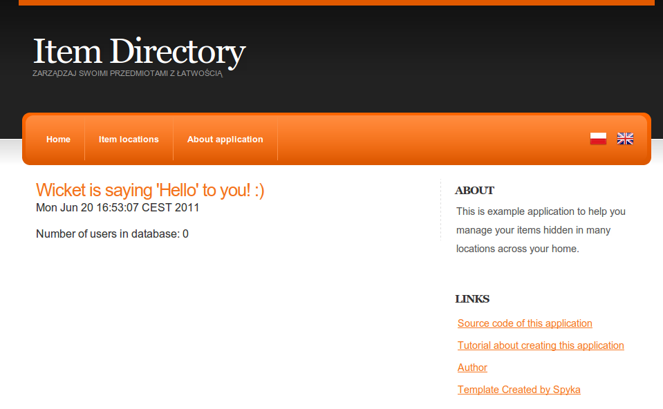
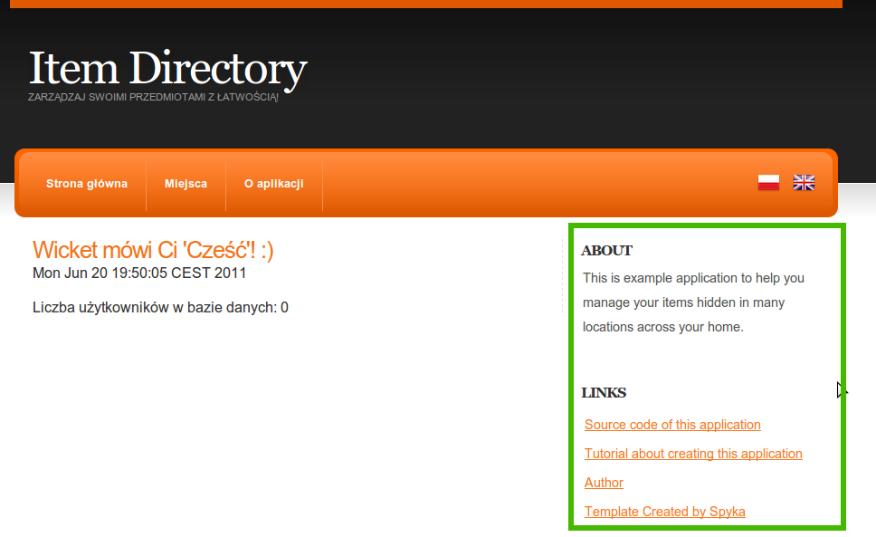

Today we will continue the Wicket tutorial series with adding support for multiple languages in the web application. Ok, let’s do it step by step.

## Create form to change language

To make our changes visible and testable at the beginning we add a form to change the application language. To make it more reusable we will implement it as a Wicket panel.
So first, let’s create html and Java files:

LanguagePanel.html

```html
<form wicket:id="languageForm" action="">
        <input wicket:id="polishButton" type="image" src="images/pl.png"
               name="image" width="25" height="25" style="border-style: none;"/>
        <input wicket:id="englishButton" type="image" src="images/gb.png"
               name="image" width="25" height="25" style="border-style: none;"/>
</form>
```

LanguagePanel.java:

```java
public class LanguagePanel extends Panel {

    Logger log = LoggerFactory.getLogger(LanguagePanel.class);

    public LanguagePanel(String id) {
        super(id);

        Form languageForm = new Form("languageForm");   // (1)

        languageForm.add(createLocaleChangingButton("polishButton", "PL"));
        languageForm.add(createLocaleChangingButton("englishButton", "GB"));

        add(languageForm);
    }

    private Button createLocaleChangingButton(final String buttonId, final String localeString) {
        return new Button(buttonId) {
            @Override
            public void onSubmit() {
                changeUserLocaleTo(localeString);    // (2)
            }
        };
    }

    private void changeUserLocaleTo(String localeString) {
        getSession().setLocale(new Locale(localeString));      // (3)
    }
}
```

As you can see it’s a simple panel with a form containing two buttons to change language to Polish and English. We just create a form **(1)**, add two buttons which both call **(2)** the same method _changeUserLocaleTo()_ **(3)** with a different parameter. The method does one, but very important thing: it changes the locale of the user Session object so all localized strings will be rendered in the chosen language.

The next thing we need to do is to add the just created panel somewhere to the application. I will place it in the header bar in the BasePage with some styling:

```html
(...)
<ul>
    <!-- MENU -->
  <li><a>Home</a></li>
  <li><a>Item locations</a></li>
  <li><a href="#">About application</a></li>
  <li style="float: right; padding-top: 20px; padding-right: 20px;">
            <span wicket:id="languagePanel"/>
        </li>
    <!-- END MENU -->
</ul>
(...)
```

We are almost done with this point but as we would like to test if language switching is working on the main page, we must add a properties file for the second language. And as properties gathered in Application.properties file don’t seem to work when the language is changed, we will move them to BasePage.properties:

```properties
applicationName=Item Directory
applicationHeader=Manage your items easily!
```

and BasePage_pl.properties (for Polish language)

```properties
applicationName=Item Directory
applicationHeader=Zarządzaj swoimi przedmiotami z łatwością!
```

Ok, it should work and when you run the jetty server _mvn jetty:run_, enter the application and click the flag of Poland you should see:



A small improvement can be done with titles of flag images to inform the user to which locale he will switch after clicking. This is a good occasion to show a nice feature of wicket:message which can render not only localized text but also to localize elements in other html tags like title in input HTML element. To make it work we simply add _wicket:message=“element_name:key_from_properties_bundle”_. In LanguagePanel.html we want to localize title so we add _wicket:message=“title:pl”_ to input:

```html
<form wicket:id="languageForm" action="">
    <input wicket:id="polishButton" type="image" wicket:message="title:pl" src="images/pl.png"
         name="image" width="25" height="25" style="border-style: none;"/>
     <input wicket:id="englishButton" type="image" wicket:message="title:gb" src="images/gb.png"
         name="image" width="25" height="25" style="border-style: none;"/>
</form>
```

and after adding pl and gb keys to the properties file we could see localized “on hover” title messages over both flags.

## Localizing messages shown to the user

After doing some tedious job (not covered here, but visible in commits) with replacing static texts with wicket:message elements and completing properties files with new keys we could introduce another Wicket feature when it comes to localization: localizing text added or created inside the Java code.

The first example of using localization in Wicket inside Java files is the welcome text on the main page. There are two ways to localize it. The worse one is getString(propertyName) method which returns localized String. But this method has one big drawback, it will work only when a new instance of Page is created. When you (like in our language switching form) return to the current page, it will use the old text value in previously selected language. This drawback is not present in the second way with [StringResourceModel](https://web.archive.org/web/20121201082500/http://wicket.apache.org/apidocs/1.4/org/apache/wicket/model/StringResourceModel.html) class:

HomePage.java:

```java
private void initGui() {
  add(new Label("helloLabel", new StringResourceModel("welcomeLabel", this, null)));
  add(new Label("currentTime", new Date().toString()));

  add(new Label("numberOfUsers", userService.size() +""));
}
```

If you are more interested in arguments of this class constructor please read [javadocs](https://web.archive.org/web/20121201082500/http://wicket.apache.org/apidocs/1.4/org/apache/wicket/model/StringResourceModel.html) where you can find a detailed description how all this stuff is working.

Another place we could use StringResourceModel is the feedback message after a location was deleted:

RemoveLocationLink fragment:

```java
@Override
public void onClick() {
  locationService.remove(location);
    getSession().info(new StringResourceModel("locationRemoved", this, null,
        new Object[] { location.getName() }).getString());
  setResponsePage(LocationsPage.class);
}
```

alongside with properties message:

```properties
locationRemoved=Location {0} was removed
```

In the constructor of StringResourceModel we pass an array of parameters which is used to prepare message. You can notice simple way of inserting passed values into text with {0} notation (like in [MessageFormat](http://download.oracle.com/javase/1.4.2/docs/api/java/text/MessageFormat.html) class). Of course this and other constructors of SRM are explained well in javadoc mentioned above 🙂 Also worth noticing is the call of getString() method on StringResourceModel which returns String representation of this ResourceModel object.

## Localizing complete pages or panels

Sometimes adding wicket:message isn’t enough and we might want to localize the whole page or panel. The first example which comes to my mind is a page with regulations in an e-shop web application. There would be a large amount of text which should be translated to the language chosen by the user. Of course we could use many, many wicket:message elements but there is a better and faster way 🙂

To show how it works we will create a localized sidebar panel of our application:



First we create an empty Java class for the panel and move sidebar markup to corresponding panel HTML file:

```java
public class RightSidebarPanel extends Panel {

    public RightSidebarPanel(String id) {
        super(id);
    }
}
```

```html
<!-- SIDEBAR -->
<h4>About</h4>
This is example application to help you manage your items hidden in many locations across your home.
<h4>Links</h4>
<ul class="blocklist">
  <li>
    <a title="Source code of this application" href="https://github.com/tdziurko/item-directory-with-wicket/tree/c9025bfb2f3fdfe0932be0805201133be39605ce">
      Source code of this application
    </a>
  </li>
  <li>
    <a title="Tutorial about creating this application"
      href="https://tomaszdziurko.com/blog/wicket-tutorial-series-building-web-application-scratch">
      Tutorial about creating this application
    </a>
  </li>
  <li>
    <a title="Tomasz Dziurko" href="http://tomaszdziurko.com/">Author</a>
  </li>
  <li>
    <a title="Spyka Webmaster resources" href="http://www.spyka.net">
      Template Created by Spyka
    </a>
  </li>
</ul>
<!-- SIDEBAR -->
```

We need to add the just created panel to BasePage java class and then, if we run the application, the home page screen won’t change at all. Ok, now we are ready for the final trick 🙂 Instead of replacing static text with wicket:message elements we create RightSidebarPanel_pl.html file next to standard one and replace the whole content with text in Polish language. After this, Wicket uses Polish HTML file when the user chooses this language and English for users visiting us from other countries. Easy and straightforward.

Ok, that’s all about localization in Wicket and in ItemDirectory application. As an extra one small improvement of usability 🙂

## Tweak page header and application title

One thing I was missing in previous versions of Item Directory was a title linked to the main page. As in many other web pages I was clicking it to navigate to the home page but previously I had forgotten to add this functionality so it didn’t work. And now, as we are adding a title in another language, it’s a good occasion to fix it. So first we embed title and header in a href elements in HTML page and then we add links to BasePage Java class:

```html
<!-- TITLE -->
<h1><a href="#" wicket:id="headerHomePageLink"><wicket:message key="applicationName"/></a></h1>
<h2><a href="#" wicket:id="headerHomePageLink2"><wicket:message key="applicationHeader"/></a></h2>
<!-- END TITLE -->
```

```java
private void addHeaderLinks() {
    add(new BookmarkablePageLink("headerHomePageLink", Application.get().getHomePage()));
    add(new BookmarkablePageLink("headerHomePageLink2", Application.get().getHomePage()));
}
```

As you can see in the HTML snippet I used _wicket:message_ element which provides simple and easy to use label in markup functionality without any Java code. So it’s good to utilize this Wicket feature in places with static text which maybe will need internationalization in the future and isn’t connected with any particular logic.

Thank you for reading. If you have any comments or ideas, don’t hesitate to share them with me and other readers below this post.
