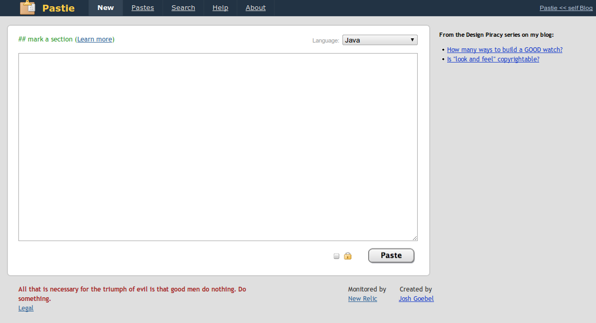
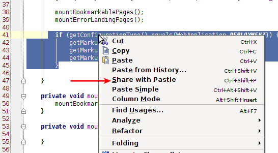
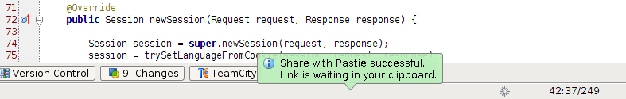
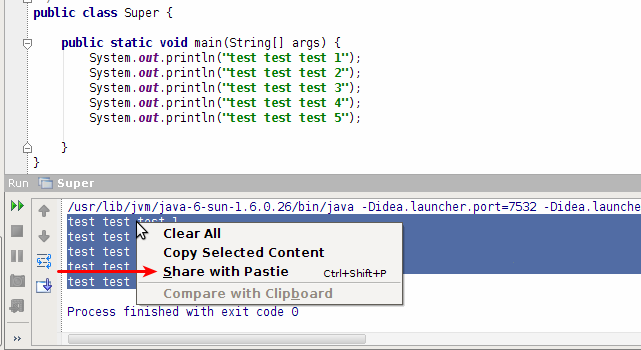
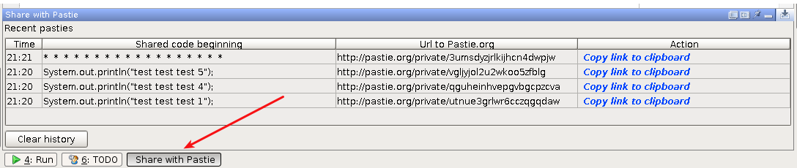

When I started working for a new company I also changed my IDE so since June I have been using IntelliJ IDEA. And I can undoubtedly say that it is worth every penny or Polish Zloty to be more precise 🙂 It is more stable than Eclipse and it has many well supported extensions which are working out of the box without any, really ANY issues.

But this is not a post about the greatness of the JetBrains product. Since we all are working remotely (max distance between developers is about 650km) we use plenty of tools which allow us to collaborate, communicate and share ideas through the Internet. Skype, GoogleDocs, [Planning Poker](http://planningpoker.com/), [tinyPM](http://tinypm.com/), company wiki are all among them. But one thing we are doing a few times each day is sharing code fragments online. When I have a problem, I post code so we can talk about it, when I have an idea how to solve something, I post code to other team members and they can say whether my solution sucks or rocks. Mostly we share code using [Pastie.org](http://pastie.org/) service.

## The problem

So the typical workflow looks like that:

1. Select interesting code fragment inside IntelliJ IDEA (two clicks)
2. Copy it (one click)
3. Enter pastie.org (two clicks: change active window to browser, open new tab with bookmarked url address)
4. Paste code fragment there (one click)
5. Choose correct language for proper syntax highlighting (two clicks and mouse scroll to find proper language)
6. Submit a form (one click)
7. Copy link from browser address bar so I can send it to other developers (two clicks)

So seven steps every time I want to share code with someone. Seven steps, eleven clicks and some mouse movement too every time… and it made me think about simplifying these repeatable tasks.

## The solution

As we are all using IntelliJ IDEA and most of the code we want to share is viewed using IDEA I thought about writing a plugin which could automate sharing code fragments with Pastie.org. And after several hours I was able to release the 0.1 version. We started using it and some new features I hadn’t thought of before were requested, also some bugs appeared too 🙂 So I spent some more time on adding new things and fixing bugs and currently [Share with Pastie](http://plugins.intellij.net/plugin/?idea&id=6267) version 0.4 is available. And now the workflow looks like that:

1. Select interesting code fragment inside IntelliJ IDEA (two clicks)
2. Press Ctrl+Shift+P or right mouse click and choose “Share with Pastie.org” (one click)

   

3. Plugin sends selected fragment to Pastie.org. Language for syntax highlighting is chosen using the file extension of the file on which “Share with Pastie” was called.
4. A link to your **private** (available only through the direct link) pastie is stored in your clipboard and you are informed about this fact by a green balloon.

   

5. You can paste the link to your teammates thousands of kilometers away from you.

So only three clicks and you have a link to your shared code fragment in your clipboard. Simple and fast. No more clicking, scrolling and manually copying the address from the browser.

## Extras

There are some additional features which were not planned at the beginning but after we started using the plugin in our everyday work, it appeared that these add-ons would be nice and useful.

**Sharing code from console**

While developing an application you might need to copy and share something not only from the opened file but from the console output (or log) your application produced. So since version 0.4 the plugin allows you to share code directly from the console view:

**Pasties history**

Sometimes you might share something with the plugin and then, without thinking, copy something else to the clipboard. And then what? Your link to the last code shared with Pastie is lost? It would be but [Tomek Szymański](http://szimano.org/) suggested an interesting feature that older links could be stored somewhere and user should be able to access them later. So I implemented a history window with recent pasties and links to them. It is available as a separate tool window at the bottom of IDEA:

Pasties are listed there starting from the newest and each item has its link which can be copied to the clipboard too.

## Summary

“Share with Pastie” can be downloaded from the central IntelliJ IDEA plugin repository – [link](http://plugins.intellij.net/plugin/?idea&id=6267).

Source code is available on GitHub – [link](https://github.com/softwaremill/idea-pastie-plugin)

If you want to receive notifications when a new version is released you can [follow me](http://twitter.com/#!/TomaszDziurko) on Twitter, check the plugin home page or its repository. If you have any suggestions, improvements, etc. you can always contact me via e-mail, Twitter or GitHub private message.

I will try to write some more about my general thoughts and experiences about developing a plugin for IntelliJ IDEA soon in a separate post.

