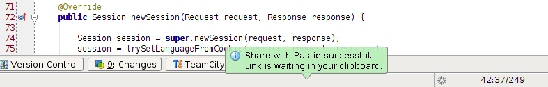
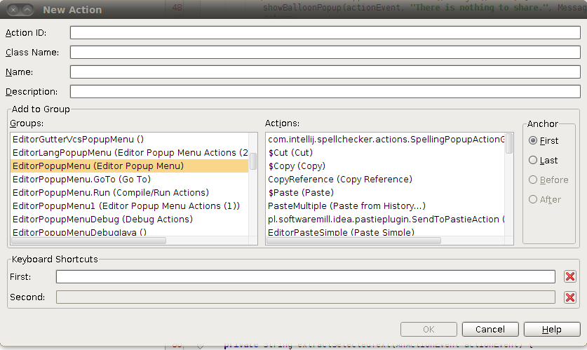
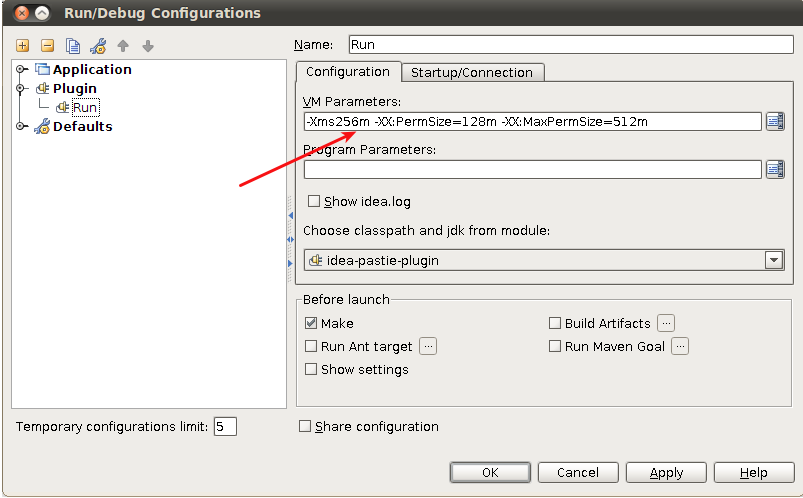

When I started thinking about writing my first plugin for IntelliJ IDEA the biggest problem was the lack of good and comprehensive guides on how to do it and how to do it well gathered in one place. So this post will be a written collection of my personal experiences, links and other resources I found useful and noteworthy on my road to releasing [Share with Pastie](/blog/share-pastie-plugin-intellij-idea) plugin to the [public IntelliJ repository](http://plugins.intellij.net/plugin/?idea&id=6267).

## Links

Before starting writing your mind-blowing and super-extra-useful plugin you should first do some reading. Below there is a list of places worth visiting:

[Getting Started](http://confluence.jetbrains.net/display/IDEADEV/Getting+Started+with+Plugin+Development) – a place where you should start. The most basic introduction to creating new plugins.

[Basics of plugin development](http://www.jetbrains.com/idea/documentation/howto_03.html) – the second page similar to the previous one but some interesting knowledge can be found there.

[Plugin Development FAQ](http://confluence.jetbrains.net/display/IDEADEV/Plugin+Development+FAQ) – the best place with ready solutions and answers to your questions and problems

[Open API forum](http://devnet.jetbrains.net/community/idea/open_api_and_plugin_development) – a place to go if you are really stuck with your problem

## Show me the code

Resources in the above links are helpful but sooner or later you will have to dive into the code to check how something works or how you could implement some feature. There are two ways of analysing the source code of IntelliJ IDEA itself:

open your console and type: `git clone git://git.jetbrains.org/idea/community.git idea`

or check [IntelliJ IDEA 10 source code at GrepCode](http://grepcode.com/snapshot/repository.grepcode.com/java/ext/com.jetbrains/intellij-idea/10.0/)

I have used both ways: Git repository to checkout the whole project, open it in IDEA and find usages, etc, and GrepCode to quickly find what a single code fragment looks like.

**Learn from others**

Sometimes you might want to add some feature which is very similar to the one you saw in a plugin written by someone else. If you are lucky, the source code of this plugin is available. The only thing you need to do is visit [http://plugins.intellij.net/?idea](http://plugins.intellij.net/?idea), find a plugin with a similar feature and check if its source code is publicly available. That’s how I found the way to add a green balloon with a message that selected code fragment was successfully shared with Pastie.

## Some useful code samples

There are a few elements which probably exist in the source code of almost every plugin. To ease your pain of googling it or trying to figure it out, here are two short samples I consider the most popular.

**Getting current project, current file, etc.**

Your plugin action should extend the AnAction abstract class from IntelliJ OpenAPI. The only parameter passed to the actionPerformed method is AnActionEvent. And from this object you can access various places:

```java
Project currentProject = DataKeys.PROJECT.getData(actionEvent.getDataContext());
VirtualFile currentFile = DataKeys.VIRTUAL_FILE.getData(actionEvent.getDataContext());
Editor editor = DataKeys.EDITOR.getData(actionEvent.getDataContext());

// and so on...
```

The list of all places available in this way can be found in [DataKeys](http://grepcode.com/file/repository.grepcode.com/java/ext/com.jetbrains/intellij-idea/10.0/com/intellij/openapi/actionSystem/DataKeys.java) class (and its parents) constants list.

**Balloon with info or error message**

This kind of popup is very useful to communicate feedback messages to the user. It can be an info message or error/warn. Default colors are green for info, red for error and orange for warnings. In Share With Pastie I am using it to inform that selected text was successfully sent to Pastie and the link is waiting in the clipboard.



But before we show our balloon we need to specify a place where it will be located. In my plugin it is StatusBar (the lowest element in IDEA GUI):

```java
StatusBar statusBar = WindowManager.getInstance()
                        .getStatusBar(DataKeys.PROJECT.getData(actionEvent.getDataContext()));
```

and then we can prepare the balloon and display it:

```java
JBPopupFactory.getInstance()
                .createHtmlTextBalloonBuilder(htmlText, messageType, null)
                .setFadeoutTime(7500)
                .createBalloon()
                .show(RelativePoint.getCenterOf(statusBar.getComponent()),
                                                 Balloon.Position.atRight);
```

## A few trivia

**Plugin DevKit**

The most important thing is to download or activate the plugin named Plugin DevKit which will allow to run and debug your own plugin during the development process. This seems extremely trivial but you might have deactivated this plugin (like me 🙂) or removed it to speed up start time.

**UI Designer**

If you are planning to develop a plugin with additional windows, popups, etc. the plugin named UI Designer is very handy. It’s something very similar to the GUI builder from NetBeans and allows you to create Swing Panels through dragging, dropping and re-sizing components.

**Group and Action IDs**

When I was searching for a proper place to show my action in one of the menus available inside IntelliJ IDEA I encountered [a page](http://keithlea.com/idea-actions/) with a list of group and action IDs which could help me with configuring my plugin. But this page appeared to be really outdated so I tried to find another way to determine the proper values of those IDs. And of course, the solution was lying just in front of me. If we press Alt + Insert in the project view we will see a menu allowing to create several new objects. And one of them is Action. After clicking it, we will see a very friendly action creator which will look like below. And of course it contains a list of available groups and actions to place our plugin menu item next to them.



**Proper VM memory settings**

The next thing is to configure your run/debug configuration to work properly because depending on your hardware setup (available memory mainly) and IntelliJ IDEA settings you might encounter freezes when starting your plugin in development mode (most frequently those are crashes during index rebuilding).



To prevent such problems you should configure memory settings in “Run/Debug Configurations” window and add proper Virtual Machine parameters. For me _-Xms256m -XX:PermSize=128m -XX:MaxPermSize=512m_ worked well.

## Summary

So this is a list of my experiences, tips and thoughts about creating your own IntelliJ IDEA plugin. I hope you find it useful and your plugin will let us (Developers) be even more productive and deliver code faster and in better quality 🙂 My friend said “If I knew how to create plugins for IDEA, I would build a new one every three weeks because I am constantly having new ideas how to improve my workflow”, so maybe after reading this post at least the start of the plugin development process will be easier.

