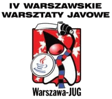

Jak co roku, w październiku rusza kolejna konferencja organizowana przez [Warszawski JUG](https://sites.google.com/site/warszawajug/), młodsza siostra [Confitury](http://confitura.pl/), czyli [Warsjawa](http://warsjawa.pl/). Edycja 2011 przynosi sporo zmian i generalnie widać, że przez rok całej imprezie znacznie się przytyło, bo w porównaniu do zeszłorocznej edycji oferuje aż 4 równoległe ścieżki: trzy poświęcone w całości zgłębieniu konkretnej tematyki poprzez warsztaty oraz czwartą, która jest ścieżką mieszaną z 2,5-godzinnymi warsztatami oraz trzema prezentacjami.

{: .tip }
Dear Reader, this post is in my native language as it covers topic that makes sense only for people from Poland. But please feel free to browse my other articles as majority of them are written in English.

Na warsztatach będzie można:

- poznać tajniki Google Web Toolkit
- napisać aplikację na platformę Android
- stworzyć projekt z użyciem Domain Driven Design oraz Command-query Responsibility Segregation
- poćwiczyć pisanie ekstremalnie obiektowego kodu pod okiem dwóch doświadczonych programistów

Ponieważ liczba miejsc na poszczególne warsztaty jest ograniczona, konieczna jest wcześniejsza rejestracja bezpośrednio ze strony każdego warsztatu.

Dodatkowo będzie możliwość zobaczenia w akcji najnowszego Tomcata ze wsparciem JEE6, zapoznania się z WebSphere Application Server 8 + OSGi oraz posłuchania o tym do czego jeszcze (poza zwykłym testowaniem) można wykorzystać takie biblioteki jak TestNG czy Mockito.

Swoją wiedzą podzielą się znani w naszej społeczności: Bartek Kuczyński, Jacek Laskowski, Krzysztof Jelski z Pawłem Lipińskim i Sławomir Sobótka. Ale, co dodatkowo bardzo cieszy, nie tylko oni, ponieważ będzie okazja zobaczyć w akcji także mniej znane szerszej publiczności osoby: Pawła Szklarza, Mateusza Grzechocińskiego, Rafała Jamroza oraz Grzegorza Abramczyka.

Oczywiście cała impreza nie mogłaby się udać bez wsparcia Partnerów konferencji, którymi w tym roku są firmy [Outbox](http://outbox.pl/), SII, [JProfiler](http://www.ej-technologies.com/products/jprofiler/overview.html), [CGI](http://www.cgi.com/), [Javart](http://www.javart.com.pl/), [TouK](http://touk.pl/) oraz [Wydział Elektroniki i Technik Informacyjnych Politechniki Warszawskiej](http://www.elka.pw.edu.pl/) jako gospodarz konferencji.

Po szczegóły odsyłam na [stronę konferencji](http://warsjawa.pl/), a także na Twittera, gdzie na bieżąco będą pojawiały się informacje na temat Warsjawy. Zachęcamy również do promowania konferencji na Twitterze (oficjalny tag to #warsjawa), a także na GoldenLine czy LinkedIn. No i do zobaczenia już za tydzień, w sobotę 15 października!

