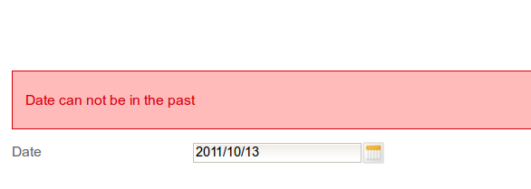
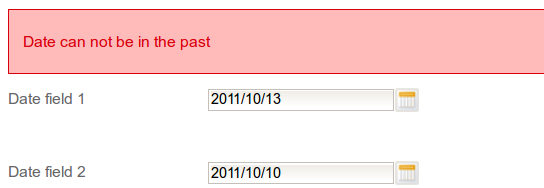
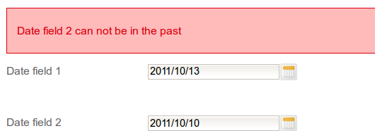

Writing a custom validator in JSF 2 is not a complicated task. You implement the _Validator_ interface, add the _@FacesValidator_ annotation and insert the validator declaration in _faces-config.xml_, that’s all. A piece of cake. But let’s consider the following scenario:

You need a custom date validator, let’s say checking that the date from _rich:calendar_ is not in the past. So we place a calendar component with the validator inside.

```xml
<rich:calendar value="#{fieldValue}" id="dateField" datePattern="yyyy/MM/dd">
    <f:validator validatorId="dateNotInThePast"/>
</rich:calendar>
```

And our validator could look like below:

```java
@FacesValidator("dateNotInThePast")
public class DateNotInThePastValidator implements Validator {

  @Override
  public void validate(FacesContext facesContext, UIComponent uiComponent, Object value)
                                                              throws ValidatorException {
    if (ObjectUtil.isNotEmpty(value)) {
      checkDate((Date)value, uiComponent, facesContext.getViewRoot().getLocale());
    }
  }

  private void checkDate(Date date, UIComponent uiComponent, Locale locale) {
    if(isDateInRange(date) == false) {
      ResourceBundle rb = ResourceBundle.getBundle("messages", locale);
      String messageText = rb.getString("date.not.in.the.past");
      throw new ValidatorException(new FacesMessage(FacesMessage.SEVERITY_ERROR,
                                     messageText, messageText));
    }
  }

  private boolean isDateInRange(Date date) {
    Date today = new DateTime().withTime(0, 0, 0, 0).toDate();
    return date.after(today) || date.equals(today);
  }
}
```

And if we provide the key value in the properties file we will see something like this:



So it looks like we have a working and production-ready custom validator.

## The problem

But while our form becomes more and more complex we might encounter the issue described on the screen below:



So the problem is how can the user determine which date is valid and which is not? Our validator uses the same property key to display both error messages.

## The solution

We need to somehow provide a label of the validated field to our custom validator. And, surprisingly for JSF, it can be achieved pretty easily. The only catch is that you have to know how to do it 🙂

So in Java Server Faces we could parametrize components with attributes (_f:attribute_ tag). So we add an attribute to rich:calendar and then read this passed value inside the validator assigned to this calendar field. So now our calendar components should look like that:

```xml
<rich:calendar value="#{fieldValue}" id="dateField" datePattern="yyyy/MM/dd">
    <f:validator validatorId="dateNotInThePast"/>
    <f:attribute name="fieldLabel" value="Date field 2" />
</rich:calendar>
```

And in our validator Java class we could get this value using _uiComponent.getAttributes().get(“fieldLabel”);_

```java
    private void checkDate(Date date, UIComponent uiComponent, Locale locale) {
        if(isDateInRange(date) == false) {
            ResourceBundle rb = ResourceBundle.getBundle("messages", locale);
            String messageText = getFieldLabel(uiComponent) +" " + rb.getString(getErrorKey());

            throw new ValidatorException(new FacesMessage(FacesMessage.SEVERITY_ERROR,
                                            messageText, messageText));
        }
    }

    protected String getFieldLabel(UIComponent uiComponent) {
        String fieldLabel = (String) uiComponent.getAttributes().get("fieldLabel");

        if(fieldLabel == null) {
            fieldLabel = "Date" ;
        }

        return fieldLabel;
    }
```

Our property value for error should have value _can not be in the past_ as _Date_ or the field label will be added at the beginning of the error message.

And a working example should show something similar to this screen:



