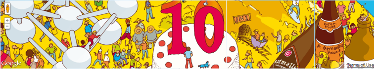
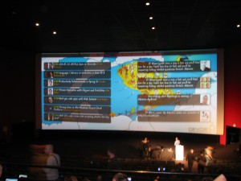

Last week I had the pleasure to attend the [Devoxx](http://devoxx.com/) conference, the biggest and one of the most known events for Java developers. As a member of a 7-man team from our company (thank you [SoftwareMill](http://softwaremill.com/) 🙂) I spent 4 days in Belgium among over 3500 developers being a witness of many great presentations and only a few not so good. Below are some of my notes and impressions.

## Devoxx conference

Devoxx (few years ago named JavaPolis) is a conference organized in Antwerp. The whole event takes place in a large cinema center allowing attendees to sit in very comfortable conditions and choose from seven (!) simultaneous sessions, each held in a separate hall. What is more interesting, keynotes were run in one hall and live-streamed to other ones so everyone could watch them like a movie on the cinema’s screen. Between sessions, also on the screens, we could read live tweet stream ([#devoxx](http://twitter.com/#!/search/%23devoxx)) so sometimes when WiFi was not working we could still see what people write about the conference and presentations, check example photo below or live site which were displayed on the screens:

After registration we received wristbands with bar code and qr code. At first it seemed strange to wear it all the time during these three days, but later when I wanted to register for a few contests and all I needed to do was to show my hand and let them scan my barcode, I started to appreciate this neat idea allowing me to spend less time writing my contact details at each sponsor booth and more time talking with people and socializing.

## Day 1

The first day started with two keynotes, one about Java SE and the later about Java EE. From the first one I’ve remembered some interesting quotes:

- There are about 9 million Java developers in the world (like the population of Switzerland)
- “Java is big. But being big won’t prevent you from extinction. You have to evolve.”
- “We will always be there for you” said by one of Oracle CEO/CTO/C-whatever, this one was especially “touching” and caused funny reactions among spectators 🙂

The second keynote was sooooo boring that I wasn’t able to note anything except the fact that Java EE 7 is planned for Q3 2012. The rest was a pure GlassFish advertisement 🙂

**Diabolical Developer**

Then I watched the “Diabolical Developer” presentation and it was one of the best talks during this conference. Martijn Verburg touched so many interesting ideas and expressed so many controversial opinions that forced me to think whether he is saying them honestly or ironically. Some of them which I was able to note:

- Agile is not a silver bullet. It is the best way to sell Scrum Certification.
- Not “the best practices”. Better practices, constantly.
- Don’t take the hype about some latest technologies too seriously. How many of you: a) are paid for developing for Android? b) had to use a NoSQL database in a real project, c) had to use Cloud? _And after each question only 5-10 out of 200-300 people raised their hands._
- Reinvent the wheel, your way is the best.
- Keep information to yourself. Knowledge is power.
- Every day stand in front of a mirror and say “I am awesome”. It will put you in a good mood 🙂

**Code Reviews**

Then during a lunch I attended one Quickie (15-min session) about Code Reviews. Some notes from this one about what can be done to improve the quality of Code Review meetings:

- Code conventions should be checked by tools
- Experts should be involved
- Newbies should be involved too, they might have a fresh idea or heard about the latest library/technology/tool/etc.
- Absolutely NO sarcasm, first sarcastic word and such person is kicked from the review meeting.
- Do not concentrate on typos and other minor errors. Talk about them after a meeting.

**Continuous Delivery**

- Small and often commits. At least one per day, optimally one per 1-2h. Later during discussion on Twitter we agreed on “one, well defined change” definition of a good commit 🙂

**Next three presentations**

Then I attended **Apache Open Web Standards** which was mainly a boring product presentation, a pretty good talk about **NoSQL** comparing Redis, Cassandra and MongoDB and then one about what is new in **Spring 3.1** which I attended to keep in touch with the latest changes in this great library.

## Day 2

**Android Keynote**

This talk had one goal: lure Java developers into Android and Android Market. We had an occasion to hear even such phrases like: _feed the hungry, clothe the naked,_ etc. But while listening to Tim Bray I was constantly thinking about the question asked during the “Diabolical Developer” presentation: How many of you are paid for developing for Android 🙂

**Spring Social**

Interesting presentation about a library to integrate your application with Facebook, Twitter, Google+ and many other websites. It’s good to know that something like this exists so you don’t need to write this code by yourself 🙂

**WWW: World Wide Wait?**

Very solid, very technical presentation comparing performance of Java Web Frameworks: GWT, Spring MVC, Vaadin, Wicket and JSF 2. GWT was the winner but what was a surprise for me was that Vaadin was the best among component frameworks. Slides are available [here](http://prezi.com/dr3on1qcajzw/www-world-wide-wait-devoxx-edition/).

**Too much email**

It was another Quickie during the lunch. This time two devs from ZeroTurnaround (JRebel) told about how they manage communication in distributed teams. They showed us their trials with Twitter as a company bulletin board and their current approach using Skype and separate chat rooms which is similar to our way of communicating in SoftwareMill.

**HTML5, Play2, Scala, CoffeeScript and Jade**

This was another very good presentation showing how [Matt Raible](http://raibledesigns.com/) fought with mentioned technologies to create his first iOS application. This talk was a great show, we even had a chance to watch a short movie showing the process of creating the application, testing it on a bike and while skiing, everything with cool music in the background ([http://youtu.be/zlF7SkxQN9Q](http://youtu.be/zlF7SkxQN9Q)).

My notes from Matt’s talk:

- The most profitable decisions you have made are those most challenging
- Best books to learn Scala (in this order): Scala for Intrigued, Scala for the Impatient
- Another very valuable resource: Twitter Scala School

His presentation is available [here](http://raibledesigns.com/rd/entry/my_html5_with_play_scala).

**jQuery Essentials**

I always wanted to know jQuery better and this presentation was a great occasion to broaden my knowledge in this area. It was really, really packed (more than 100 slides!) with examples of how jQuery works. I can’t wait to see those slides published somewhere on the Internet. Meanwhile another good resource about jQuery suggested by [Addy Osmani](http://addyosmani.com/blog/) is [jQuery fundamentals](http://jqfundamentals.com/).

**Java and Home Automation**

Very interesting and entertaining presentation about how Java can be used to automate everyday tasks in our houses. During his talk Vinicius Senger showed how to change the color of lights using a specific tweet, how to start and stop home devices using our beloved language. After he had revealed the tweet command to interact with the light bulb, people started tweeting and changing the colour of lights as he was speaking 🙂 Generally, jHome Automation API looks very promising. The second part of the presentation was held by Eric Bariaux and was about [Open Remote](http://openremote.org/display/HOME/OpenRemote) project. This part was more serious but it also contained a video demonstration of how this project could be used to control various devices in our houses.

## Day 3

The last day of Devoxx started with a Technical Discussion Panel with participation of Joshua Bloch, Brian Goetz, Ben Evans, Mark Reinhold, Emmanuel Bernard and Brian H. Prince (so Oracle, Google, Microsoft and some neutrals 🙂). Many interesting questions were asked and many interesting discussions took place during this panel. I think it will be worth watching it on [Parleys](http://www.parleys.com/) when it will be available.

**Securing Java EE Web Apps**

During this talk we have learnt how easily a hacker can exploit some bugs in our web application to grant him admin privileges, etc. Two interesting tools were introduced: Browser Exploitation Framework (BeEF) and [sqlmap](http://sqlmap.sourceforge.net/). They can be used both to perform security and penetration tests or to attack our website.

- [XSS (Cross Site Scripting) Prevention Cheat Sheet](https://www.owasp.org/index.php/XSS_%28Cross_Site_Scripting%29_Prevention_Cheat_Sheet), an article with a list of steps that should be taken to make an XSS attack much more difficult
- [ESAPI](https://www.owasp.org/index.php/Category:OWASP_Enterprise_Security_API) (OWASP Enterprise Security API), a library which makes it easier to write more secure web applications
- [SANS.org](http://www.sans.org/), a website with trainings, certificates and free resources about security

**What Shazam doesn’t want you to know**

In this presentation Roy van Rijn has told us about his clash with [Shazam](http://www.shazam.com/) as after two days of programming he found out how (more or less) the Shazam algorithm works and, surprisingly, watchful lawyers from this company claimed that he infringed their software patent and must remove the post from his blog. Of course Roy refused but it is an interesting case how every developer while creating something could unknowingly “violate” someone’s software patent.

## Other stuff

If you really want to read more about Devoxx 2011 below are some links to other places where you can find more information about this conference:

- official summary: [http://www.devoxx.com/display/DV11/2011/11/22/Devoxx+2011+The+Good,+The+Bad+and+The+Ugly](http://www.devoxx.com/display/DV11/2011/11/22/Devoxx+2011+The+Good,+The+Bad+and+The+Ugly)
- Backstage of Devoxx: [http://www.touilleur-express.fr/2011/11/15/devoxx-2011-who-are-those-angels/](http://www.touilleur-express.fr/2011/11/15/devoxx-2011-who-are-those-angels/)
- [http://dailylog.lenart.org.pl/2011/11/21/shared-experience/](http://dailylog.lenart.org.pl/2011/11/21/shared-experience/)
- http://blog.jqno.nl/devoxx-2011-post-mortem
- [http://javaheap.wordpress.com/2011/11/19/devoxx-2011/](http://javaheap.wordpress.com/2011/11/19/devoxx-2011/)
- http://theworldisanapple.com/devoxx-2011/
- [http://labs.consol.de/lang/de/blog/devoxx/devoxx-2011-wrap-up/](http://labs.consol.de/lang/de/blog/devoxx/devoxx-2011-wrap-up/)
- [http://blog.avisi.nl/2011/11/18/devoxx11-3/](http://blog.avisi.nl/2011/11/18/devoxx11-3/)
- [http://odedpeer.blogspot.com/2011/11/devoxx-2011.html](http://odedpeer.blogspot.com/2011/11/devoxx-2011.html)
- [http://blogs.oracle.com/geertjan/entry/what_is_happening_vs_what](http://blogs.oracle.com/geertjan/entry/what_is_happening_vs_what)
- [http://www.tbray.org/ongoing/When/201x/2011/11/21/Devoxx](http://www.tbray.org/ongoing/When/201x/2011/11/21/Devoxx)
- http://jthoenes.bergischweb.de/2011/11/18/devoxx-2011-ive-been-in-paradise/
- [http://blogs.oracle.com/arungupta/entry/it_happens_only_at_devoxx](http://blogs.oracle.com/arungupta/entry/it_happens_only_at_devoxx)
- [http://wwwilpower.blogspot.com/2011/11/devoxx-2011-meet-us-in-paradise.html](http://wwwilpower.blogspot.com/2011/11/devoxx-2011-meet-us-in-paradise.html)
- [http://mechanitis.blogspot.com/2011/11/devoxx-story-so-far.html](http://mechanitis.blogspot.com/2011/11/devoxx-story-so-far.html)
- [http://www.jorambarrez.be/blog/2011/11/21/devox-2011-impressions/](http://www.jorambarrez.be/blog/2011/11/21/devox-2011-impressions/)
- [http://www.xenonique.co.uk/blog/?p=551](http://www.xenonique.co.uk/blog/?p=551)
- [http://blog.nava.de/2011/11/24/devoxx-2011-ruckblick/](http://blog.nava.de/2011/11/24/devoxx-2011-ruckblick/) (in German)
- Video relation: [http://vimeo.com/3217035](http://vimeo.com/32170355)
- Summary after discussion panel about women in IT at Devoxx: [http://mechanitis.blogspot.com/2011/11/why-we-shouldnt-target-women.htm](http://mechanitis.blogspot.com/2011/11/why-we-shouldnt-target-women.html)
- Photos: [https://picasaweb.google.com/100790864147050997007/Devoxx2011#](https://picasaweb.google.com/100790864147050997007/Devoxx2011#)
- Photos 2: [https://plus.google.com/u/0/photos/118041907032714528693/albums/5676724380994368977](https://plus.google.com/u/0/photos/118041907032714528693/albums/5676724380994368977)

Uff, that’s all for now. Thank you for reading! 🙂

