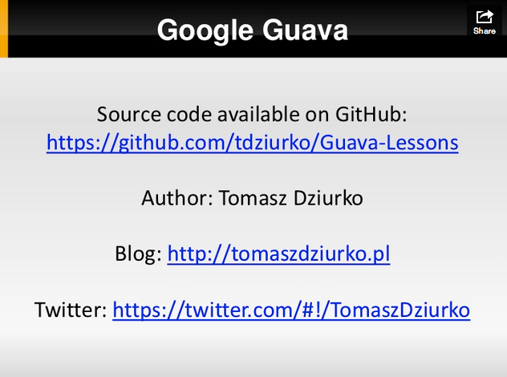

Some time ago at [SoftwareMill](http://softwaremill.com/) during our weekly Friday meeting to share knowledge I’ve presented Google Guava API. And as it ended with quite a long presentation and quite many lines of code I thought that this might be interesting for some Java Developers outside our company.

So below there are slides presenting the most useful and interesting features of [Google Guava](http://guava-libraries.googlecode.com/) (v.11). I didn’t cover every class from this library, there are no examples from cache and concurrent packages as I don’t find this part of Guava as really, really useful for every Java Programmer. If you need caching or concurrency support, there is some interesting stuff for you in packages I mentioned earlier.

Slides are available here:

Source code is available on GitHub – [https://github.com/tdziurko/Guava-Lessons](https://github.com/tdziurko/Guava-Lessons) and the PDF can be downloaded from [here](/files/google-guava.pdf).

If you have any feedback or suggestions, please share them in the comments. I am more than happy to learn something new.
