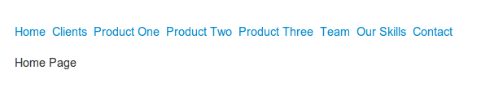
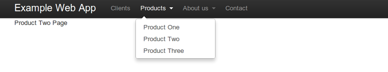
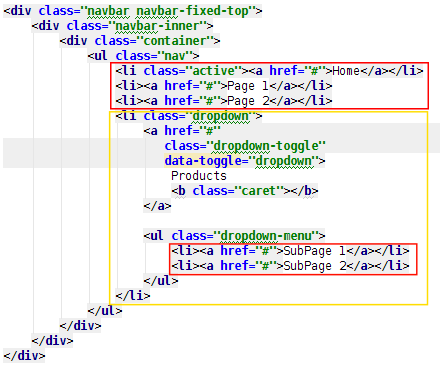

All of you probably heard about Twitter Bootstrap, an awesome set of components allowing to create nice looking web pages and applications without diving deeply into CSS/JS hacks. If you want to see what this library is capable of, please visit [http://builtwithbootstrap.com/](http://builtwithbootstrap.com/) and check how people use it to build their websites.

But this post isn’t supposed to be about Bootstrap itself. In a few next paragraphs I will present how I created a reusable Wicket component containing the Bootstrap top navigation bar menu. And the final result using Wicket in our example web-app will look this way:

Before styling applied:



After:



And what is most important, ready component can be used without any, really any modification in HTML files, everything is defined using pure Java:

```java
add(new TwitterBootstrapNavBarPanel.Builder("navBar", HomePage.class, "Example Web App", getActiveMenu())
        .withMenuItem(MenuItemEnum.CLIENTS, ClientsPage.class)
        .withMenuItemAsDropdown(MenuItemEnum.PRODUCTS, ProductOnePage.class, "Product One")
        .withMenuItemAsDropdown(MenuItemEnum.PRODUCTS, ProductTwoPage.class, "Product Two")
        .withMenuItemAsDropdown(MenuItemEnum.PRODUCTS, ProductTwoPage.class, "Product Three")
        .withMenuItemAsDropdown(MenuItemEnum.ABOUT_US, TeamPage.class, "Team")
        .withMenuItemAsDropdown(MenuItemEnum.ABOUT_US, OurSkillsPage.class, "Our Skills")
        .withMenuItem(MenuItemEnum.CONTACT, ContactPage.class)
        .build());
```

If you are ‘show-me-the-code’ kind of guy, please go directly to my [project on Github](https://github.com/tdziurko/wicket-bootstrap-navbar) which contains a working example of a web application with this navigation bar. If you want to read an explanation of how this stuff works, please keep reading.

## Step 1: Some preparations

NavBar component allows to display the active menu item in a different way so the user is able to determine where he/she is. So in our web application every web page should inform to which menu item it belongs so it could be highlighted accordingly.

So in our BasePage class we add a method:

```java
public abstract MenuItemEnum getActiveMenu();
```

returning defined enum:

```java
public enum MenuItemEnum {
    CLIENTS("Clients"),
    PRODUCTS("Products"),
    ABOUT_US("About us"),
    CONTACT("Contact"),
    NONE("");

    private String label;

    private MenuItemEnum(String label) {
        this.label = label;
    }

    // ...
}
```

 _None_ value is used by home page because it does not belong to any particular menu item. Other pages (product pages, client, etc.) return one of the other enum values presented above.

## Step 2: Splitting markup into reusable pieces

Clean markup of Bootstrap NavBar may look like that:



And if you look attentively enough you will notice that it could be divided into smaller, reusable and independent elements:

- each of these three `<li>` inside red rectangle represents a single menu item and is almost the same, only the active menu item has an additional class parameter.
- `<li>` inside a yellow rectangle is a dropdown menu item and it contains a label, some styling and two elements that are the same as the single menu items described above

So basically we should have three classes:

1. Panel class representing the whole NavBar, that will be our _TwitterBootstrapNavBarPanel_
2. Panel class for a single `<li>` menu item – _MenuLinkItem_
3. Panel class for a single `<li>` dropdown menu – _MenuDropdownItem_ – that also will contain a few _MenuLinkItem_ elements to represent items inside this dropdown

So let’s start with the simplest one.

## Step 3: Single menu item element – MenuLinkItem

Markup of this simple element is really non-complicated, only one link.

```html
<wicket:panel>
        <a href="#" wicket:id="link"/>
</wicket:panel>
```

Its Java class is small and easy to grasp:

```java
public class MenuLinkItem extends Panel {

  public MenuLinkItem(String id, BookmarkablePageLink pageLink, boolean shouldBeActive) {
      super(id);
      add(pageLink);
      if (shouldBeActive) {
          add(new AttributeAppender("class", " active "));
      }
  }
}
```

What we can see above is a simple panel accepting three parameters, standard Wicket element id, page link to place in this menu item and an indicator saying if this item should be displayed as an active. This is accomplished by adding an _active_ class name to CSS class element.

## Step 4: Dropdown menu item element – MenuDropdownItem

Now it’s getting a little harder as we want to create a panel for our menu item containing a dropdown. Its markup:

```html
<wicket:panel>
    <li class="dropdown" wicket:id="itemContainer">
        <a href="#" class="dropdown-toggle" data-toggle="dropdown">
            <span wicket:id="label"/>
            <b class="caret"></b>
        </a>
        <ul class="dropdown-menu">
            <li wicket:id="itemLinks"></li>
        </ul>
    </li>
</wicket:panel>
```

So what we have here:

- Wicket label (id=_label_) to display as a… label of this dropdown item
- `<ul>` element containing a list of `<li>` elements represented by Wicket id=_itemLinks_
- and finally, component wrapping everything above: id=_itemContainer_

And Java class for this panel:

```java
public class MenuDropdownItem extends Panel {

  public MenuDropdownItem(String id, MenuItemEnum currentMenuItem,
          Collection> linksInMenuItem, boolean shouldBeActive) {
      super(id);

      WebMarkupContainer itemContainer = new WebMarkupContainer("itemContainer");  // (1)
      if (shouldBeActive) {
          itemContainer.add(new AttributeAppender("class", " active "));   // (2)
      }
      itemContainer.add(new Label("label", currentMenuItem.getLabel()));   // (3)

      RepeatingView repeatingView = new RepeatingView("itemLinks");   // (4)

      for (BookmarkablePageLink link : linksInMenuItem) {    // (5)
          MenuLinkItem menuLinkItem = new MenuLinkItem(repeatingView.newChildId(), link, false);
          repeatingView.add(menuLinkItem);
      }

      itemContainer.add(repeatingView);
      add(itemContainer);
  }
}
```

You may think _Whoaa, this is a complicated one_ 🙂 But relax, let me explain it step by step:

1. Here we create a container to add label and link items. Container is necessary because sometimes we would like to add _active_ styling here so it has to be a Wicket component.
2. If this item should be active, add proper styling.
3. Add label element.
4. To render all item links in our dropdown we need a repeater. Wicket provides many [repeater components](http://www.wicket-library.com/wicket-examples/repeater/) but why do we use RepeatingView? Because this one does not produce any additional markup and renders only inside markup where it is located (more details in [javadoc](https://web.archive.org/web/20150223192038/http://wicket.apache.org/apidocs/1.5/index.html?org/apache/wicket/markup/repeater/RepeatingView.html)). So in our case, it renders as a few `<li>` elements without any additional html which is good to keep everything in line with Twitter Bootstrap styling.
5. For every link passed to our dropdown item we create a new _MenuLinkItem_ (do you remember when I underlined that dropdown will contain a list of menu item elements?)

And that’s all, this component is clear now, isn’t it? 🙂

## Step 5: Merging everything together

So we have two components ready to use in our main panel. Now it is time to introduce the panel class and markup – _TwitterBootstrapNavBarPanel_. Markup luckily isn’t complicated:

```html
<div class="navbar navbar-fixed-top">
   <div class="navbar-inner">
     <div class="container">// (1)
       <div class="nav-collapse">
         <ul class="nav">
           <ul class="nav">
         <li>// (2)</li>
           </ul>
         </ul>
       </div>
     </div>
    </div>
  </div>
```

1. This is a link with a label to redirect the user to the home page of our application.
2. This is a repeater to render all menu items (simple ones and dropdown as well)

Although the markup is not difficult to understand even at first glance, Java class is different and needs more detailed explanation. Because I wanted NavBar creation process to be as seamless as possible I used a fluent interface with the Builder pattern. So first, let’s concentrate on this element:

```java
public static class Builder implements Serializable {

        private String id;
        private Class homePage;
        private String applicationName;
        private MenuItemEnum activeMenuItem;

        private Multimap> linksMap = LinkedHashMultimap.create();  // (3)

        public Builder(String id, Class homePage, String applicationName,   // (1)
                       MenuItemEnum activeMenuItem) {
            this.id = id;
            this.homePage = homePage;
            this.applicationName = applicationName;
            this.activeMenuItem = activeMenuItem;
        }

        public Builder withMenuItem(MenuItemEnum menuItem, Class pageToLink) {  // (2)
            Preconditions.checkState(linksMap.containsKey(menuItem) == false, "Builder already contains " + menuItem +
                    ". Please use withMenuItemInDropdown if you need many links in one menu item");   // (4)
            BookmarkablePageLink link = new BookmarkablePageLink("link", pageToLink);
            link.setBody(new Model(menuItem.getLabel()));    // (5)
            linksMap.put(menuItem, link);   // (6)
            return this;
        }

        // ...
}
```

So what’s happening here:

1. Our panel needs three mandatory things: Wicket component id, application name to render a label and home page class to create a link so those three things will go to the Builder constructor
2. This method is responsible for collecting data for simple menu item so we need a menu item enum and class of the page that we want link to in the navigation bar
3. To gather all the data we use Google Guava Multimap with MenuItemEnum as a key and a Bookmarkable Links as values. Multimap is a kind of map which allows multiple values for a single key.
4. But for a simple menu item we don’t want to have more than one menu item duplicated in the navigation bar so we prevent it with a Preconditions check.
5. For a simple item we want to have a label equal to MenuItemEnum label so we add body to the link.
6. And put link in our multimap.

Now let me explain the two last methods in the Builder class:

```java
    public Builder withMenuItemAsDropdown(MenuItemEnum menuItem, Class pageToLink, String label) { // (1)
        BookmarkablePageLink link = new BookmarkablePageLink("link", pageToLink);
        link.setBody(new Model(label));
        linksMap.put(menuItem, link);
        return this;
    }

    public TwitterBootstrapNavBarPanel build() {   (2)
        return new TwitterBootstrapNavBarPanel(this);
    }
```

1. This method is used to add elements to the dropdown menu item. Here we allow multiple values for the same menu item (as we will render them as a dropdown under a single label). Additionally in the params list we need a label for each link as the enum label will be used to render menu item itself and not the links inside it.
2. And when we’re ready we execute build() that calls private panel constructor.

## Step 6: Panel class

We have everything set up, Builder has all the data we need to create our panel so let’s go to its constructor.

```java
private TwitterBootstrapNavBarPanel(final Builder builder) {
    super(builder.id);

    BookmarkablePageLink homePageLink = new BookmarkablePageLink("homePageLink", builder.homePage); // (1)
    homePageLink.add(new Label("label", builder.applicationName)); // (2)
    add(homePageLink);

    RepeatingView repeatingView = new RepeatingView("menuItems");  // (3)

    for (MenuItemEnum item : builder.linksMap.keySet()) {   // (4)
        boolean shouldBeActive = item.equals(builder.activeMenuItem);

        Collection> linksInThisMenuItem = builder.linksMap.get(item);  // (5)

        if (linksInThisMenuItem.size() == 1) { //(6)
            BookmarkablePageLink pageLink = Iterables.get(linksInThisMenuItem, 0);

            MenuLinkItem menuLinkItem = new MenuLinkItem(repeatingView.newChildId(), pageLink, shouldBeActive);
            repeatingView.add(menuLinkItem);
        } else {    // (7)
            repeatingView.add(new MenuDropdownItem(repeatingView.newChildId(), item, linksInThisMenuItem,
                    shouldBeActive));
        }
    }

    add(repeatingView);
}
```

1. Create link to the home page
2. Set its label
3. Create empty repeater
4. For each key from Multimap …
5. Get collection of links to place in current menu item
6. If there is only one link, add simple menu item (_MenuLinkItem_ element)
7. Otherwise, create _MenuDropdownItem_ with collection of links

## Summary

And that’s all. We went through the complete process of building a reusable Wicket component based on top of the existing Twitter Bootstrap UI framework. And now it is easy to reuse it in a few next web applications we will create with Wicket.

Of course styling (colors, fonts, etc.) might be different but when we create an internal application for an insurance company or for a bank, they don’t expect UI to be really, really, really awesome. It just should look nice and that’s all. If you have such requirements, Twitter Bootstrap is the tool to choose. And when you encapsulate it with your Java web framework of choice you will get a ready to use element that just works.
