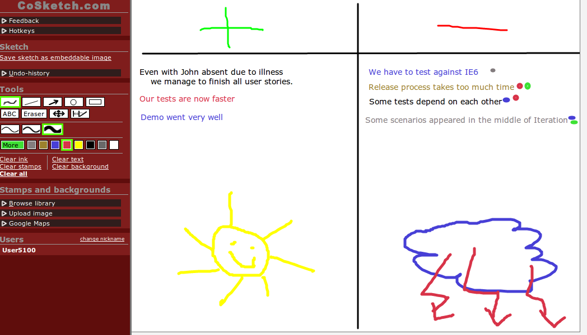
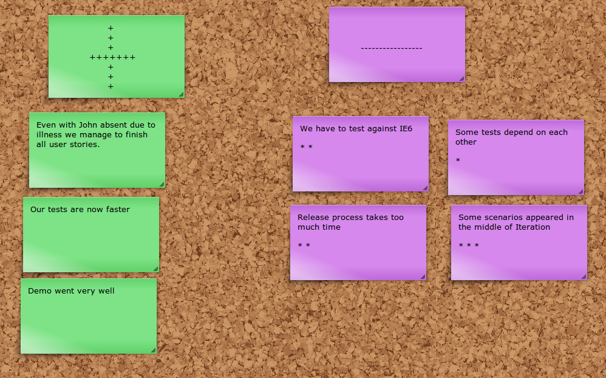
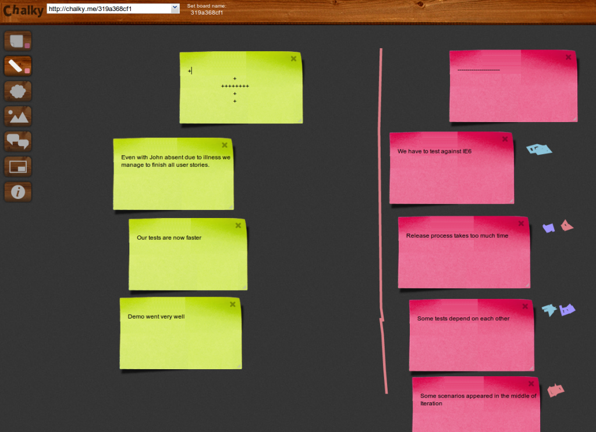

In [our](http://softwaremill.com/) company we work remotely from different locations across Poland. And because we work using agile, after each iteration (in my project usually every 2 weeks) we have a sprint retrospective when we share our insights about what was good and bad in the last sprint. Then we vote on minuses, discuss them and try to extract action items to perform so those problems are less likely to recur in the future.

A standard retrospective is easy, you sit next to other people from your project and simply discuss. But when there are hundreds of kilometers between team members, you need a tool (except Skype of course 🙂) that will allow to conduct a successful retro. Below I share my opinions about three tools that might be essential for distributed teams and distributed retrospectives.

### [Cosketch](http://cosketch.com/)

**Pros:**

- Many, many colors (every team member can pick one)
- You can actually draw something
- Each item occupies only small area, good if you have many people and many items
- Changes history and “undo”

**Cons:**

- Someone can think it’s too complicated
- Does not look so nice
- It sometimes has problems with synchronization across the Internet. I can see something that other team members can’t

### [Corkboard](http://corkboard.me/)

**Pros:**

- Clean and simple
- A few colors to pick
- All required features and nothing more

**Cons:**

- Each item takes some space and re-sizing is limited
- No extra features
- No drawing, only text

### Chalky

**Pros:**

- Looks almost like a real blackboard
- Cool drawing
- Each note can have comments

**Cons:**

- Small number of colors
- Each item takes some space and re-sizing is limited
- Sometimes size changes without a reason causing problems like with this drawn “plus” sign
- Login only via Facebook

## Summary

Each of these tools is useful and may be suitable for some teams depending on their size/project specific needs/etc. Currently in our project we are using **Corkboard** mainly because of its simplicity. My team is relatively small (3 up to 4 people) so none of Corkboard’s drawbacks is really a problem for us.

And maybe you are using a different tool that helps with retrospectives? If so, please drop a note in the comments.
