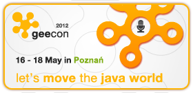

This year is very intensive with regard to IT conferences. I’ve already attended three of them and at least two more are scheduled. The last event I’ve had a pleasure to participate in was [GeeCON 2012](http://2012.geecon.org/) in Poznań. Below are some of my personal impressions after this event.

## 0

**Number of my earlier GeeCONs**

This year was my first presence at GeeCON. I have been attending conferences regularly for a few years but surprisingly I’ve never been to GeeCON before. This year the conference was held in a large cinema complex with comfortable armchairs and large rooms, so there were plenty of seats at most of the talks (maybe only a few of them attracted so many programmers that someone had to sit on the floor). And if we are talking about the venue, the climate was very Devoxx-like which I consider as a big plus.

**Number of changing rooms**

Zero is also the number of changing rooms. Unfortunately there was no place to drop your jacket (unless you had some friends from the GeeCON crew) so I consider this as a small drawback. I know, I know, there is no changing room in a cinema but hey… we’re agile and some temporary solution could have been arranged 🙂

## 1

**Only one key-note as good as GeeCON talk by Kevlin Henney during other conferences this year**

I didn’t expect that at all. Closing key-notes are rarely really good. People are tired after those sleepless nights during the conference, speakers are tired too, we all feel dull and often you can feel it during the last talks. But sometimes it’s otherwise. And that was the case at GeeCON. Not that I wasn’t tired but _Cool Code_ by [Kevlin Henney](http://2012.geecon.org/speakers/kevlin-henney) was really great. This year only the [Jurgen Appelo](http://www.jurgenappelo.com/) key-note during [33rdDegree](http://2012.33degree.org/) was as good as _Cool Code_. Even the talk by _Uncle Bob_ wasn’t as good as Kevlin’s one so if you missed it, regret it and then regret it again and then… wait until GeeCON organizers publish videos 🙂

During this talk we were shown code snippets that are cool in various ways. We saw an error which led to a rocket explosion, a bash script that does sorting using the sleep command and even a chess game with a simple AI with only a few hundred lines of code. Really amazing and refreshing closing key-note!

**Number of books I bought during the conference**

For every book publisher an IT conference is a good place to sell its titles, for us an additional 20-30% discount is also a good thing to have so I see growing numbers of stands with books during such events. GeeCON was no different and had Helion (IT books publisher from Poland) present with some discounts and interesting titles. But during this conference we had something less usual. A self-publishing author, Tomek Kaczanowski, who was also a speaker at GeeCON was selling his book _Practical Unit Testing with TestNG and Mockito_ ([http://practicalunittesting.com/](http://practicalunittesting.com/)). And because this book is getting some good reviews, is about good and efficient testing in Java and finally the author is my fellow Pole, I didn’t hesitate to buy it. If you’re really into testing in Java, you should consider doing the same 🙂

## 3

**Three opening key-notes**

The first day of the conference started with three key-notes by Bruce Eckel, Ivar Jacobson and Gavin King. Bruce Eckel’s talk was quite good, Ivar’s was decent and didn’t catch my attention and the last one by Gavin about Ceylon was very controversial and extremely biased. The speaker criticized almost every popular language and praised his own, Ceylon. Talk was hard to forget but, mainly due to the very biased approach, I didn’t like it.

## 4

**Four pubs in Bar-Hopping contest**

[Allegro](http://allegro.pl/), one of the sponsors, organized an entertaining contest. During evening/night after the first conference day every attendee could get a free beer in one of four pubs in Poznań’s Old Market Square. With every beer we received a stamp on a coupon. Those who collected all four stamps could win a prize if they woke up very, very early the next morning and showed up near the Allegro stand in the conference hall. Unfortunately I chatted too long in one of the pubs and when we reached the last one, there was no one giving stamps 😉 But the whole idea of the contest was great and fun was great as well, during that evening I had an opportunity to talk with old friends, meet many new interesting people and even chat with some homeless guy who (if we would give him 5 Polish Zlotys) promised that he could make the Polish national team finish Euro 2012 as runners-up 🙂

## Around 10

**Number of f*cks and other curses during Ceylon key-note**

I like passionate people, most of GeeCON attendees are passionate about what we do but passion is one thing and cursing to a few hundred people is another one. One or two f*cks are ok, but not ten or even more. And unfortunately during the third key-note Gavin King crossed the line. Maybe Ceylon is good, but presenting this language this way will not lure new programmers into yet-another JVM language. Below are some interesting tweets summarizing people’s feelings during Gavin’s talk 🙂

- After listening to Gavin King about [#Ceylon](http://topsy.com/s?q=%23Ceylon&utm_source=ottertag) I maybe understand why authors of [#Kotlin](http://topsy.com/s?q=%23Kotlin&utm_source=ottertag) refused to work with him. [#geecon](http://topsy.com/s?type=tweet&q=%23geecon) – [link](https://twitter.com/novoj/status/203071063867928576)
- [#ceylon](http://topsy.com/s?q=%23ceylon&utm_source=ottertag) Gavin King is having a bad day. Angry and cursing way too much. Come on, relax! [#geecon](http://topsy.com/s?type=tweet&q=%23geecon) – [link](https://twitter.com/codecopkofler/status/203067974960168960)
- Listening to gavin king at [#geecon](http://topsy.com/s?type=tweet&q=%23geecon) … dude you should at least pretend you are modest :p hard to listen to you without getting biased – [link](https://twitter.com/szimano/status/203066626193620992)
- [#geecon](http://topsy.com/s?type=tweet&q=%23geecon) Enjoying the [#ceylon](http://topsy.com/s?q=%23ceylon&utm_source=ottertag) talk with Gavin King and his nice and gentle way of expressing his opinions :–) – [link](http://twitter.com/adambien/status/203066600990048257)

## 11

**SoftwareMill crew at GeeCON**

In [SML](http://softwaremill.com/) we try to attend conferences as often as possible but this time we’ve beaten the record. Last year there were seven of us at Devoxx in Belgium but this time we’ve managed to appear in the team of eleven people! And as we work remotely, such an event was another good occasion to meet and integrate with people I code with every day.

## 65,79

**Approximate length of ID lanyard in centimetres**

ID lanyards are something we receive at almost every conference. It’s completely fine as organizers need to identify people who are paid attendees and prevent some non-paying visitors during the event. IDs are also very helpful when we are having a conversation with some strangers because sometimes it turns out that we know each other from Twitter, blogs, etc. But in my opinion lanyards from GeeCON were too long and when you tried to see your interlocutor’s name you basically had to stare at his … let’s say place below his belly button 🙂

## The end

To sum up, GeeCON was a very good conference but people I met there were even better and more interesting. And I think that’s the case for most events, not the agenda, venue nor speakers, but talks with interesting and passionate people are things making such events a great place to be.
