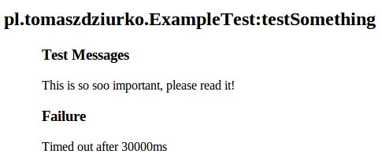

Book “_Practical Unit Testing with TestNG and Mockito_” ([website](http://practicalunittesting.com/)) covers a wide spectrum of knowledge about testing in the Java environment using aforementioned libraries. But if you prefer JUnit over TestNG or PowerMock over Mockito, it is still a valid and very good source of information about proper and painless testing. But of course, TestNG and Mockito users will be able to get the most of this title. Below you can read some of my thoughts after reading this book.

## Quick look at content

[Tomek Kaczanowski](http://kaczanowscy.pl/tomek/), the author of this book, starts with describing some basic concepts needed to understand testing and classification of tests. He introduces definitions of SUT – System Under Test and DOC – Depended On Component. Then after this really short theoretical chapter we start diving deeper into gradually more and more complex testing cases.

We start with a simple class without any dependencies, easy to understand and easy to test. Then we could feel the rhythm of Test-Driven Development with TestNG, learn how to use mocks, stubs and spies from Mockito, employ matchers and checking assertions using FEST. Example after example, we are introduced to more complex features of those libraries. But luckily for those not using TestNG with Mockito, each chapter is full of general tips and suggestions about testing methodology, how to approach testing properly and finally how and what to test.

Then we could learn about customizing TestNG using listeners and reporters, organizing test classes into packages and modules, organizing code in test methods (famous BDD given-when-then trio).

The last chapters are devoted completely to the most general things: maintaining tests, deciding which parts of your code base are worth testing, checking quality of your tests with static analysis tools (PMD, Cobertura and so on).

## My opinion

I have been using TestNG for over a year (after switching from JUnit), Mockito for more than three years so I am quite familiar with those tools. And for people with similar or greater experience this book will not surprise on each single page. This will or, at least in my opinion, will happen for those less familiar with testing and using TestNG and Mockito. For them this book is a totally must read as it gently introduces the reader to the world of proper unit testing using the best tools available in Java world.

I am far from saying that for more experienced developers this book is not a good way to spend their time. It’s still good, I learned many interesting features of described libraries but what is most important, my knowledge about testing is now more complete and more ordered. Reading all this stuff helped me to put a lot of stuff into “proper shelves” in my mind. And that’s very good.

**To sum up:** The less experienced in testing you are, the more you will get from this book. And for people who are testing and using TestNG and Mockito for eight or more years: this book is probably not for you.

If you place yourself in the middle, _Practical Unit Testing with TestNG and Mockito_ is still a very good choice as it will help you to systematize all the stuff you already know and meanwhile you will surely learn something new about tools and, worth noting, about general efficient and painless approach to testing your code.

## My takeaways

Below are some of my personal notes about things I didn’t know or didn’t use often before reading this book.

**Enriching html test reports**

TestNG has a nice class _org.testng.Reporter_ that allows a developer to add some information to html reports

```java
@Test
public void testSomething() {
    Reporter.log("This is so soo important, please read it!");

    //test something
}
```

And after running such tests in html report we will see something like presented on the screenshot below:



and additionally all such messages are gathered in one, separate report.

**Clear separation between important and dummy test data**

Let’s suppose that we are testing the following method

```java
@Test
public void loadByAgeRange() {
    service.loadClientBy(1, 20, 40, null);
}
```

and compare it with listing below:

```java
@Test
public void loadByAgeRange() {
    int ageFrom = 20;
    int ageTo = 40;

    service.loadClientBy(ANY_TYPE, ageFrom, ageTo, ANY_REGION);
}
```

Isn’t it much clearer? We replace dummy data with constants indicating which part is important and what parameters are not critical in this method.

**Mocks auto injection**

Mockito allows us to automatically inject all mocks into the object we are going to test:

```java
@InjectMocks private ObjectUnderTest object = new ObjectUnderTest();
```

Of course it has some limitations (see [JavaDocs](https://javadoc.io/doc/org.mockito/mockito-core/1.9.0/org/mockito/InjectMocks.html)) but it’s good to know that such feature is already in Mockito.

**[Make-it-easy](http://code.google.com/p/make-it-easy/) – A tiny framework that makes it easy to write Test Data Builders in Java**

This small project will help you to create builders for your test cases easily. More can be found on [its wiki](http://code.google.com/p/make-it-easy/wiki/GettingStarted), but below is a simple use case showing how it looks:

```java
Person nat = make(a(Person, with(name, "Tomek"), with(age, 28)));
```

**Partial Mocking**

If there is a method we want to test but at the same time there is another method in the tested object that we want to mock, it is possible to do that by using Mockito spy():

```java
@Test
public void testCaluculationSummary() {
    TestedObject object = spy(new TestedObject());
    when(object.executeHeavyCalculations()).thenReturn("resultString");

    int result = object.getCalculationsSummary();

    assertThat(result).isEqualTo(10);
}
```

**Testing and capturing method arguments**

Mockito gives us another very useful feature, the ability to check what arguments were passed to methods using [ArgumentCaptor](https://site.mockito.org/javadoc/current/org/mockito/ArgumentCaptor.html):

```java
@Test
public void testArgument() {
    // ...
    CustomerService customerService = mock(CustomerService.class);
    ArgumentCaptor argument = ArgumentCaptor.forClass(Customer.class);
    verify(customerService).saveCustomer(argument.capture());

    testedObject.executeSomeMethodCallingSaveCustomer()

    assertThat(argument.getValue()).isEqualTo(expectedCustomer);
}
```
