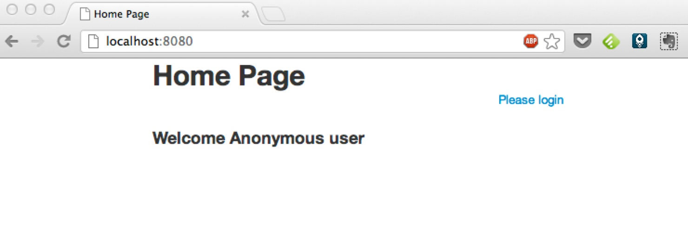
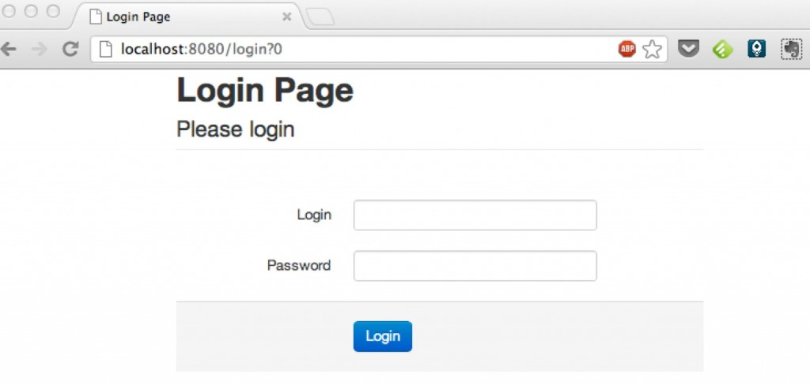
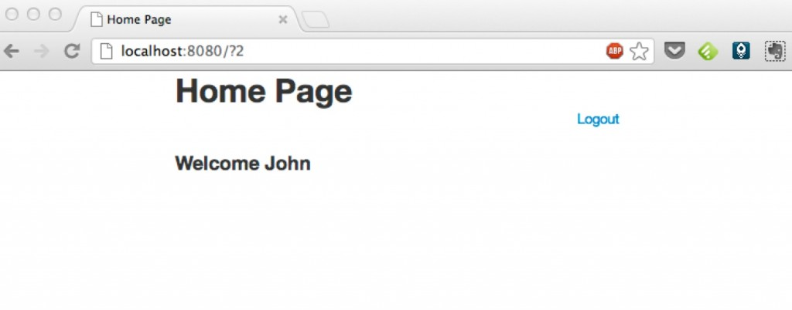
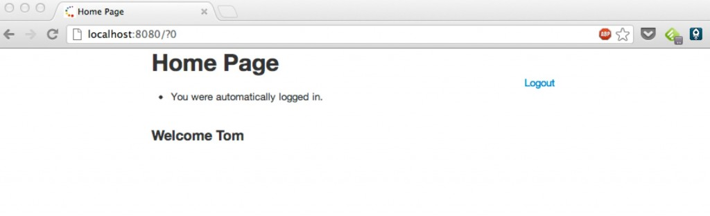

It is quite common in web applications to have “Remember Me” functionality that allows the user to be automatically logged in each time when he visits our website.

Such feature can be implemented using [Spring Security](https://spring.io/projects/spring-security), but in my opinion using a request based authentication framework with a component based web framework is not the best idea. These two worlds just do not fit well together so I prefer to use my own baked solution which I will present below.

## Base project

We start with a simple web application written using the latest, still hot [Apache Wicket 6](https://wicket.apache.org/news/2012/09/05/wicket-6.0.0-released.html). You can download complete sources from [GitHub](https://github.com/tdziurko/wicket-rememberme) and start the application using `mvn clean compile jetty:run`.

Base application consists of two pages:

- Home Page: displays a welcome message for logged and not-logged users or either logout or login link.
- Login Page: allows the user to login based on a simple in-memory collection of users. Some working login/password pairs: John/john, Lisa/lisa, Tom/tom.







## Remember Me functionality

The standard way to implement Remember Me functionality looks as follows:

1. Ask the user if he wants to be remembered and auto-logged in the future.
2. If so, save cookies with login and password on his computer.
3. For every new user coming to our website, check if cookies from step 2 are present and if so, auto login the user.
4. When he manually logs out, remove cookies so it is possible to clear data used to auto-login.

Point 2 needs some explanation. In this example app we are going to save login and **not hashed, not encrypted** password in cookies. In a real scenario this is unacceptable. Instead of it, you should consider storing hashed and salted password so even if someone intercepts the user cookie, the password will still be secret and more work will be needed to decode it.
**Update:** [Michał Matłoka](https://twitter.com/mmatloka) posted two very interesting links on how this could be done in real systems. Those approaches do not even use password nor password hashes. For more details please look into his comment below this post.

**Step 1: As a User I want to decide if I want to use “Remember Me” feature**
[Link to commit with this step](https://github.com/tdziurko/wicket-rememberme/commit/c5e91b39a203c9103754f8a03ab2e4151fc9e199)

To allow the user to notify the application that he wants to use ‘Remember Me’ functionality we will simply add a checkbox to the login page. So we need to amend LoginPage java and html files a bit:

```html
<form wicket:id="form" class="form-horizontal">
    <fieldset>
        <legend>Please login</legend>
    </fieldset>

    <div class="control-group">
        <div wicket:id="feedback"></div>
    </div>
    <div class="control-group">
        <label class="control-label" for="login">Login</label>
        <div class="controls">
            <input type="text" id="login" wicket:id="login" />
        </div>
    </div>
    <div class="control-group">
        <label class="control-label" for="password">Password</label>
        <div class="controls">
            <input type="password" id="password" wicket:id="password" />
        </div>
    </div>
    <div class="control-group"> <!-- this div is new -->
        <div class="controls">
            <label class="checkbox">
                <input type="checkbox" wicket:id="rememberMe"> Remember me on this computer
            </label>
        </div>
    </div>
    <div class="form-actions">
        <input type="submit" wicket:id="submit" value="Login" title="Login" class="btn btn-primary"/>
    </div>
</form>
```

```java
private String login;
private String password;
private boolean rememberMe;

public LoginPage() {

    Form<Void> loginForm = new Form<Void>("form");
    add(loginForm);

    loginForm.add(new FeedbackPanel("feedback"));
    loginForm.add(new RequiredTextField<String>("login", new PropertyModel<String>(this, "login")));
    loginForm.add(new PasswordTextField("password", new PropertyModel<String>(this, "password")));
    loginForm.add(new CheckBox("rememberMe", new PropertyModel<Boolean>(this, "rememberMe"))); // this line

    Button submit = new Button("submit") {
        // (...)
    };

    loginForm.add(submit);
}
```

Now we are ready for the next step.

**Step 2: As a System I want to save login and password in cookies**
[Link to commit with this step](https://github.com/tdziurko/wicket-rememberme/commit/b9a419161871b47821171790f443cf92869ac631)

First we need a CookieService that will encapsulate all logic responsible for working with cookies: saving, listing and clearing cookies when needed. Code is rather simple, we work with WebResponse and WebRequest classes to modify cookies in user’s browser.

```java
public class CookieService {

    public Cookie loadCookie(Request request, String cookieName) {

        List<Cookie> cookies = ((WebRequest) request).getCookies();

        if (cookies == null) {
            return null;
        }

        for (Cookie cookie : cookies) {
            if(cookie.getName().equals(cookieName)) {
                return cookie;
            }
        }

        return null;
    }

    public void saveCookie(Response response, String cookieName, String cookieValue, int expiryTimeInDays) {
        Cookie cookie = new Cookie(cookieName, cookieValue);
        cookie.setMaxAge((int) TimeUnit.DAYS.toSeconds(expiryTimeInDays));
        ((WebResponse)response).addCookie(cookie);
    }

    public void removeCookieIfPresent(Request request, Response response, String cookieName) {
        Cookie cookie = loadCookie(request, cookieName);

        if(cookie != null) {
            ((WebResponse)response).clearCookie(cookie);
        }
    }
}
```

Then when the user checks ‘Remember Me’ on LoginPage, we have to save cookies in his browser:

```java
Button submit = new Button("submit") {
    @Override
    public void onSubmit() {
        UserService userService = WicketApplication.get().getUserService();

        User user = userService.findByLoginAndPassword(login, password);

        if(user == null) {
            error("Invalid login and/or password. Please try again.");
        }
        else {
            UserSession.get().setUser(user);

            if(rememberMe) {
                CookieService cookieService = WicketApplication.get().getCookieService();
                cookieService.saveCookie(getResponse(), REMEMBER_ME_LOGIN_COOKIE, user.getLogin(), REMEMBER_ME_DURATION_IN_DAYS);
                cookieService.saveCookie(getResponse(), REMEMBER_ME_PASSWORD_COOKIE, user.getPassword(), REMEMBER_ME_DURATION_IN_DAYS);
            }

            setResponsePage(HomePage.class);
        }
    }
};
```

**Step 3: As a User I want to be auto-logged when I return to web application**
[Link to commit with this step](https://github.com/tdziurko/wicket-rememberme/commit/59cb50d433a79a73b1020b488d5a13a7355da0d3)

To check if a user entering our application is a “returning user to auto-login” we have to enrich the logic responsible for creating a new user session. Currently it is done in WicketApplication class which when requested, creates a new WebSession instance. So every time a new session is created, we have to check for cookies presence and if they are a valid user/password pair, auto-login this user.

So let’s start with extracting session related logic into a separate class called SessionProvider. It will need UserService and CookieService to check for existing users and cookies so we pass them as references in the constructor.

```java
public class WicketApplication extends WebApplication {

    private UserService userService = new UserService();
    private CookieService cookieService = new CookieService();
    private SessionProvider sessionProvider = new SessionProvider(userService, cookieService);

    @Override
    public Session newSession(Request request, Response response) {
        return sessionProvider.createNewSession(request);
    }
}
```

The role of SessionProvider is to create a new UserSession, check if proper cookies are present and if so, set logged user. Additionally we add a feedback message to inform the user that he was auto logged. So let’s look into the code:

```java
public class SessionProvider {

    public SessionProvider(UserService userService, CookieService cookieService) {
        this.userService = userService;
        this.cookieService = cookieService;
    }

    public WebSession createNewSession(Request request) {
        UserSession session = new UserSession(request);

        Cookie loginCookie = cookieService.loadCookie(request, REMEMBER_ME_LOGIN_COOKIE);
        Cookie passwordCookie = cookieService.loadCookie(request, REMEMBER_ME_PASSWORD_COOKIE);

        if(loginCookie != null && passwordCookie != null) {
            User user = userService.findByLoginAndPassword(loginCookie.getValue(), passwordCookie.getValue());

            if(user != null) {
                session.setUser(user);
                session.info("You were automatically logged in.");
            }
        }

        return session;
    }
}
```

To show the feedback message on HomePage.java we must add FeedbackPanel there, but for brevity I will omit this in this post. You can read [commit](https://github.com/tdziurko/wicket-rememberme/commit/59cb50d433a79a73b1020b488d5a13a7355da0d3) to check how to do that.

So after three steps we should have ‘Remember Me’ working. To check it quickly please modify the session timeout in web.xml file by adding:

```xml
<session-config>
    <session-timeout>1</session-timeout>
</session-config>
```

and then start the application `mvn clean compile jetty:run`, go to the login page, login, close the browser and after over 1 minute (when session expires) open it again on [http://localhost:8080](http://localhost:8080/). You should see something like this:



So it works. But we still need one more thing: allow the user to remove cookies and turn-off auto-login.

**Step 4: As a User I want to be able to logout and clear my cookies**
[Link to commit with this step](https://github.com/tdziurko/wicket-rememberme/commit/d9b35803ea0321dc5e80f80d480a6af527a457fa)
In the last step we have to allow the user to clear his data and disable “Remember Me” for his account. This will be achieved by clearing both cookies when the user explicitly clicks Logout link.

```java
Link<Void> logoutLink = new Link<Void>("logout") {
    @Override
    public void onClick() {
        CookieService cookieService = WicketApplication.get().getCookieService();
        cookieService.removeCookieIfPresent(getRequest(), getResponse(), SessionProvider.REMEMBER_ME_LOGIN_COOKIE);
        cookieService.removeCookieIfPresent(getRequest(), getResponse(), SessionProvider.REMEMBER_ME_PASSWORD_COOKIE);

        UserSession.get().setUser(null);
        UserSession.get().invalidate();
    }
};
logoutLink.setVisible(UserSession.get().userLoggedIn());
add(logoutLink);
```

## Summary

So that’s all. In this post we have implemented a simple ‘Remember Me’ functionality in a web application written using Apache Wicket without using any external authentication libraries.
