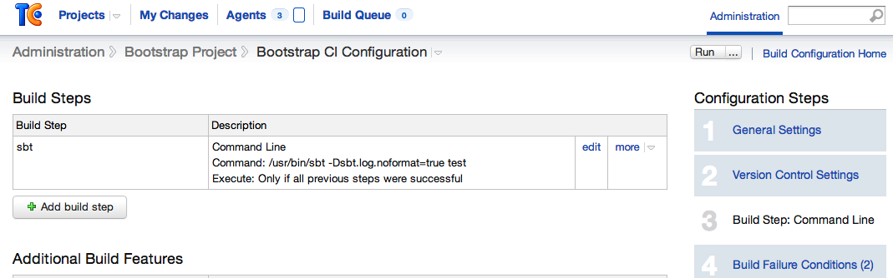
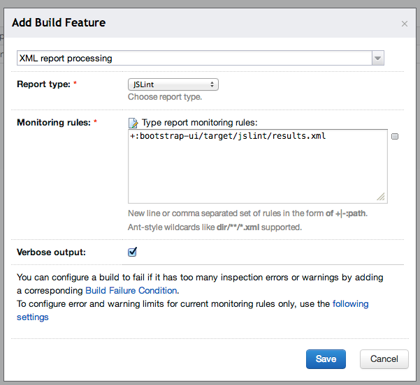
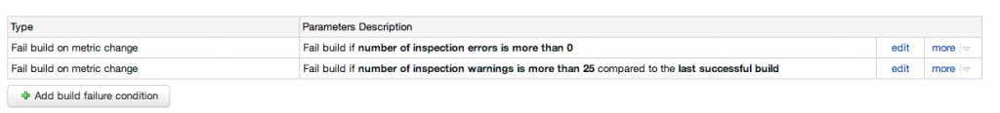
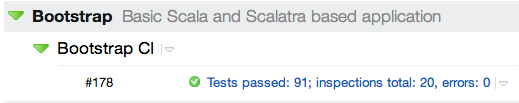

In this post I will shortly describe the configuration process of the JSLint SBT plugin and then the TeamCity build config that reacts on errors/warnings raised by this plugin.

## Problem

In my current project we are working with rather non-standard technologies for a decent Java developer. Our backend runs on Scala and [Scalatra](http://www.scalatra.org/) and serves pure JSON to the frontend written in JavaScript and [AngularJS](https://docs.angularjs.org/). And as we are far from being seasoned JS developers, we want to have the quality of our JS codebase guarded by some automatic tool.

### Toolbox

After some research it appeared that [JSLint](http://www.jslint.com/) is for JS the same as [FindBugs](http://findbugs.sourceforge.net/) for Java so we decided to try it out in our project. Luckily there is a [JSLint SBT plugin](https://github.com/philcali/sbt-jslint) so we weren’t forced to carve our own solution.

## Configuration

### SBT-JSLint plugin

According to the documentation to configure the plugin we have to perform the two following steps:

1. Add plugin declaration to Plugins.scala file

   ```scala
   object Plugins extends Build {
     lazy val plugins = Project(
       "plugins",
       file("."),
       settings = Defaults.defaultSettings ++
         Seq(addSbtPlugin("com.github.philcali" % "sbt-jslint" % "0.1.3"))
     )
   }
   ```

2. Include plugin settings in Build.scala:

   ```scala
   import sbtjslint.Plugin._
   import sbtjslint.Plugin.LintKeys._
   
   // ...
     lazy val ui: Project = Project(
       "bootstrap-ui",
       file("bootstrap-ui"),
       settings = buildSettings ++ lintSettings
     )
   ```

But as usual these steps are not enough. First of all, when we run _sbt jslint_ we will see that it scans some default directory looking for JS files to analyse. And of course our JavaScript lies in a completely different place. Secondly, we want to add the _jslint_ step to the build process so it is executed every time. So simply, we need lintCustomSettings with declared custom JS location and the jslint step process added to the test step in our build:

```scala
val lintCustomSettings = lintSettings ++ inConfig(Test)(Seq(
    sourceDirectory in jslint <<= (baseDirectory)(_ / "src/main/webapp/app"),
    compile in Test <<= (compile in Test) dependsOn (jslint)
  ))

  lazy val ui: Project = Project(
    "bootstrap-ui",
    file("bootstrap-ui"),
    settings = buildSettings ++ lintCustomSettings
  )
```

Now after running _sbt test_ we will see that JavaScript code is checked and the report is printed to the console and also written in target/jslint/results.xml file.

When you analyse report.xml you might be overwhelmed by the number of warnings raised by the plugin. Some of them are quite useful, but some might be ignored or, even better, disabled by custom flags. In our project we use something like:

```scala
flags in jslint ++= Seq("undef", "vars", "browser")
```

added to lintCustomSettings. For more flags and their descriptions please visit [plugin documentation](https://github.com/philcali/sbt-jslint/blob/master/README.md#some-notes).

### Team City config

Now, as we have our plugin running and generating report.xml, we could configure the TeamCity build to react on JS errors and warnings.

Simply go to _Edit Configuration Settings_ of your build and then choose “Build Step: Command Line”:



And in the section Additional Build Features click “Add build feature”, choose “XML report processing”, then “JSLint” and specify the path to the report.xml file. Personally I also check “Verbose output” to see more details in the build log.



After saving we can go to the next build step named “Build failure conditions” and define two new rules there so we end up with something similar to the screen presented below:



And finally our build is fully configured to report and react on problems in JavaScript files:



Reference commits from my current project:

- [commit 1](https://github.com/softwaremill/bootstrap/commit/1a2d764db96c58ded2c07c9b88a6214f9b1b5794)
- [commit 2](https://github.com/softwaremill/bootstrap/commit/c284acadcfdcad5cdaad1f082a6dab51d1f92107) (only the last modification in Build.scala)
