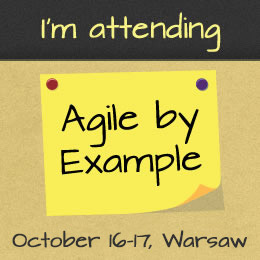

Notes, thoughts and comments after my second agile conference in my career. A few interesting ideas, some already known approaches. Anyway, I do not regret being there.

I’ve just returned from my trip to Warsaw to attend the 3rd edition of [Agile By Example](http://agilebyexample.com/).

Here are my thoughts, impressions and notes after this event.

## Overview

This year’s Agile By Example (or simply ABE) was my 2nd visit to this conference, I’ve missed only the first edition. Last year I felt really refreshed by the conference built not only around code, coding, testing and developing software. This edition was bigger and had more famous speakers, also the venue was really much more impressive. Cinema (as everyone who attended [Devoxx](http://www.devoxx.be/) can confirm) is a great place to hold any event of this type and Kino Praha was no different. Enormous screen, climatic rooms and cozy seats are things that really improve the perception of the conference.

## Day One – notes

**Jeff Sutherland, opening key**

Presentation by one of the fathers of Scrum. Evangelistic, as expected, but too much about Scrum as a “silver bullet” that will solve all our problems, every time, everywhere.

- Plan for interruptions. In each iteration add a buffer to deal with unexpected stuff when it appears. Also add time to improve the process to each sprint.

**Paweł Brodziński – Building Teams**

- Really controversial with saying that we should hire women even if their technical skills are below the level we look for. It was said that a woman will increase cognitive intelligence in a team and will recompensate lower skills with increasing diversity and the mentioned type of intelligence.
- From conversation with Paweł during the break, my question: What should be the accepted difference between the skill of a hired woman and the rest of the team. Answer: “Level that won’t cause a woman to hate you that you hired her and level that won’t cause the team to hate her and you”. Pretty obvious, but thought provoking.

**Tomek Włodarek – Are we agile yet**

- Scrumpede – 1. Sudden frenzied rush of (panic–stricken) organizations to do Scrum because it is the next best thing. 2. To flee in a headlong rush back to prescriptive ways of doing things because Scrum is difficult and hard work.
- Very interesting quote _“Without knowledge action is useless and knowledge without action is futile.”_, so even with the best intentions we are to fail if we aren’t equipped with knowledge of what should be done and how it should be done correctly.

**Michał Prządka – Get agile and don’t die trying**

- Don’t start with transforming the whole organization or big part of it. Start with a small team, and then, step by step build an agile environment around it.
- Some people might not fit into a new model of work. Some even say that it might be up to 30% that decide to leave a company if the issue is not addressed properly
- Get help from coaches, agile mentors. My comment: Strangely it was repeated many times during the conference by different speakers. And what is most interesting, they weren’t these coaches but people that hired an agile coach that proved to help a lot and be successful and now they are suggesting similar steps to the other teams/organizations. It could mean that such transformations are much easier with the assistance of someone who has “been there, done that”.
- Kanban is deceptively simple, but requires a really high level of discipline to work. Albeit it’s not the best idea to start “being agile” with Kanban
- If you can introduce only one practice, start with retrospective meetings. They really change a lot.

**Sandro Mancuso – Software Craftsmanship**

The most entertaining presentation during the first day. There were some “shits”, many laughs, but also many comments on how we should be a craftsman in what we do. If you can attend any of Sandro’s talks, please do it or at least try to watch a video. It’s really worth it 🙂

- We should prepare code in the project to accept changes in the future so that adding new stuff won’t become painful and slow

## Day Two – notes

**Jurgen Appelo – keynote**

Jurgen is a quality speaker and his performance during ABE confirmed that. The talk was about intrinsic motivators, driving a change and convincing people to do what we want. An overview of his CHAMPFROGS model was published on Jurgen's blog.

- _Fake it until you make it_ which means faking optimism will actually make you more optimistic and change the way other people perceive you.
- Look like a successful person, people like to be close to the success.

**Paul Klipp – Kanban**

Well prepared thoughts after five years of using Kanban in Paul’s company. What didn’t work, what they did about it and what were the results. Short stories from a seasoned agile advocate.

**Malcom Peacock – Planning a release**

Very interesting analogy between planning a family car trip and planning a release of a product/project.

- Satellite navigation is our source of estimations, but we have to add some time for unexpected stuff that might appear during the travel.
- Geographical position is an analogy to requirements, if we get wrong position, estimations will be incorrect and we will never reach our destination.
- In case of any delays, update the release plan as Sat Nav updates estimated date of arrival.
- Inform product owner about changes as you would inform your passengers.

**Michał Ostruszka – Code Reviews**

This one is hard to judge as Michał, like me, is one of [twenty CEOs](https://softwaremill.com/20-ceos-in-one-company/) in [SoftwareMill](https://softwaremill.com/) 🙂 Code reviews are a very important part of our development process and Michał told about experiences, problems and solutions that should help when introducing or struggling with code reviews in your organization.

**Tomasz Borowski – Spaceship Commander**

Very interesting talk about introducing gamification to solve some problems in an organisation. Lessons learnt during the process, examples what worked well, things that didn’t and had to be changed along the way. The game written as a core of described gamification process is available online and also open sourced on [GitHub](https://github.com/miksturait/YouGame).

- Beware of ending in pontification instead of gamification.
- Hide worst performers to avoid stupid managers using results of the game as a reason to fire people.
- _Results of the game are base to yearly bonuses_. I am not sure if I got it correctly, but this one is in my opinion a huge mistake. Instead of gamification we end up with bonusification and all fun that comes with gamifying things in company is severely damaged. Ok, Tomasz wrote me a tweet that they are not using YouGamApp to calculate bonuses. But they have something interesting instead just to allow people to give kudos to other team members. Please check readme on this [project’s GitHub page](https://github.com/miksturait/merit-money).

**Marek Kirejczyk – Agile Office**

Marek showed us the office of his company where thanks to visualisation of many things (burn-down charts, organisation changes kanban board, etc.) they radically increased transparency and empowered agile climate in [elPassion](http://www.elpassion.com/).

**Tom Gilb – Agility is the Tool, not the Purpose**

Tom is called the grand-father of Scrum as he introduced very similar concepts some time before Scrum was created. His talk was about how to by measuring impact of different project areas / functionalities / submodules on features/results we could analyze and pick the ones with the highest effect and lowest cost. He showed a rather complicated matrix from which company was able to choose on which area concentrate first. Concept is quite similar to [impact mapping](http://impactmapping.org/), but Tom’s approach is more rigid and number-based. And for me it looks as both advantage and drawback: numbers should give a pretty objective view on project but on the other side, they are taken from discussions with people, so they can also be incorrect and subjective as well. Nevertheless, I feel this approach can be quite successful for smaller groups of people and not very complicated feature/impact matrix.

**Surprise talk – Iwona Cymerman**

The speaker and topic of this talk weren’t revealed earlier and many people stayed until the end of the event to see what this surprise is about. And I think no one was disappointed.

The most inspiring presentation of the conference. Iwona told us about introducing agile practices (stand-up meetings, pomodoro, agile manifesto) in her job which is not IT-related at all. She’s a scientist in a Lab conducting various biology researches. She also presented a history about how she started a movement that forces Parliament in Poland to change wrong law that affects every scientist in our country (vote will take place in a few weeks, fingers crossed).

## Summary

After the first day of ABE 2013 I felt a little bit disappointed, there was no “wow” effect, I’ve made some notes but during breaks we shared similar thoughts with a few colleagues that maybe we are too agile-aware to learn anything new during this event. But then, 2nd day came by and everything changed. Topics were more interesting, talks more engaging and solutions more inspiring so at the end I can tell that even for someone who works in an agile environment for about 3 years it was well spent time. Some new stuff, some inspirations and of course, a great occasion to share and discuss our problems and approaches with people from different companies and with different experiences.
