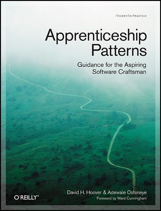

130 pages to help you nurture your passion and become a better developer. Pretty good deal, isn’t it?

Between reading hardcore programming books (like [“Scala for the impatient”](https://www.goodreads.com/book/show/11335855-scala-for-the-impatient), [“Programming in Groovy”](https://www.goodreads.com/book/show/18006341-programming-groovy-2), etc.) and completely off-topic books read for pure pleasure ([“I am Zlatan”](https://www.goodreads.com/book/show/21890735-i-am-zlatan) or [“World War Z”](https://www.goodreads.com/book/show/8908.World_War_Z)) I like to read something “soft” but still allowing me to be a better developer.

There are many books about being a good developer, but recently when I was “feeding” my bookshelf one title caught my attention: [“Apprenticeship Patterns: Guidance for the Aspiring Software Craftsman”](https://www.goodreads.com/book/show/5608045-apprenticeship-patterns).

**Important note:** After finishing the book I’ve learnt that its online version is available for free [here](http://chimera.labs.oreilly.com/books/1234000001813/index.html) 🙂

The book has a rating of 4.11 on [GoodReads](https://www.goodreads.com/book/show/5608045-apprenticeship-patterns) (I consider any book with a rating higher than 4.0 as a very good candidate to read) and many positive reviews so I’ve decided to spend a few evenings with it in my hands. Below you can read my review and some notes I’ve made during reading.

## Your Guidance as an Aspiring Software Craftsman

The book isn’t very long (about 130 pages) and is written in a concise language with concrete ideas so you won’t get bored at any point. “Apprenticeship Patterns” consists of six main parts, each with 5-10 short chapters. Every chapter is about one “pattern”. A pattern is something similar in concept to a “design pattern” and describes a generic problem or situation in which every developer can find themselves.

Each of the patterns has a well defined context in which it can occur, a problem which we are facing and of course, solution and action points that should be taken. While reading this book I was surprised that many patterns happened to me during my career as a developer. Luckily, some actions I took were correct (or at least suggested in the book). But on the other side, some of them weren’t and now I have some thoughts and ideas what I could improve. The book is easy to read as each pattern forms a separate story that fits perfectly into a single evening reading session.

**My short summary of the main parts so you can get an idea of what’s inside**

1. Patterns approach is described and explained here.
2. Chapter is about starting the adventure as a developer, learning the first language, coping with own ignorance and choosing topics to learn at the beginning.
3. Is for those planning to be a developer for most of their career. It is about _“walking the long road”_ when at the start we are far behind other developers with much more experience and knowledge but thanks to constant learning and well-thought decisions in the long term we could even overtake them.
4. Helps us to accurately self-assess our skills, strong and weak points.
5. Helps to set up the basement for perpetual learning, nurturing our passion and creating feedback loops. Everything is about habits and conscious decisions.
6. Can be shortened to _“read, read constantly, read classics, read what people you admire suggest”_.

## Review Summary

> Best development book I’ve read, has no code in it – quote from [http://arasatasaygin.com/](http://arasatasaygin.com/)

I can guarantee that you won’t be disappointed after reading this book. Not only is it well written, short and concise but it also contains many interesting and very useful ideas that we could apply in our work to help our skills grow and our career flourish.

I can only regret that I’ve read it after almost 7 years of work as a developer. It would be even more useful if I had done it at the early stage of my career.

### Notes to myself made during reading

- [“Working effectively with legacy code”](https://www.goodreads.com/book/show/44919.Working_Effectively_with_Legacy_Code) – strongly suggested book
- Pick one skill, tool, or technique and actively fill the gaps in your knowledge about it
- Breakable toys – build an application using tools/languages you want to master at home, in the environment where you are safe to fail
- People aspiring to become masters of software craftsmanship need to plan for the long term
- The things we build for customers **can** be beautiful but **must** be useful
- If you’re worried that your current job is rotting your brain, it probably is
- [StickyMinds.com](http://www.stickyminds.com/) – interesting portal about quality in our industry
- Your goal should be to become skilled rather than experienced
- Keep reading! Keep your personal reading list so you always have some books to choose from (my personal choice is [GoodReads](http://goodreads.com/))
- Keep a list of even small things you’ve learnt. Some kind of diary where you can put all meaningful stuff you encounter during your daily job.
