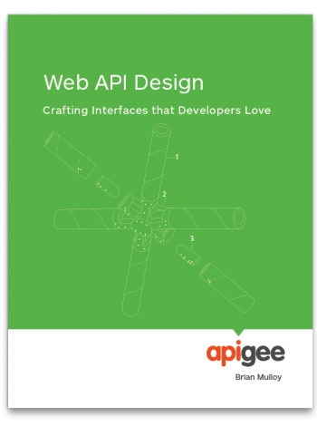

Trying to be perfect in a never taught art.

Several years ago our projects were lone islands, doing everything inside, sometimes communicating via a database or from time to time via XML and Web Services. Rarely did a developer have to consume a sophisticated API and almost never we had to create one. And because there was no need to write that, no one was teaching how to do it properly.

Nowadays things look completely different, we live in the era of public APIs: Twitter, Facebook, microservices, nanoservices, two-line-services. Everything should have a perfect REST API: well thought out, nicely designed and easy to use. But how to achieve these goals? This is the main subject of a short book “Web API Design – Crafting Interfaces that Developers Love” by Brian Mulloy [available for free on ApiGee site](http://apigee.com/about/resources/ebooks/web-api-design).

## What is this book about

I am not going to write a full abstract because this book is extremely short (and again, [free](http://apigee.com/about/resources/ebooks/web-api-design)), only 36 pages so you can read it in two evenings. It is showing good practices when creating REST APIs with many real-life examples taken from such prominent companies as Google, LinkedIn, Facebook and Netflix.

We can learn that:

- nouns should be used for naming instead of verbs
- we should not have more than two endpoints per resource
- error indication should be done via HTTP Statuses (we can start with three: 200 – ok, 400 – request was not ok, 500 – something went wrong)
- but with human readable error messages that can be displayed when necessary
- API version should be mandatory
- the place where the version should be stored is not yet standardised, there are two approaches: url or request headers.

So if you are in the “chatty” project communicating with others via REST or trying to make your API as usable for other developers as possible, you should really, really consider reading this paper. Short, concise and straight to the point.

PS: Many thanks to [Rafał Remisiewicz](https://www.linkedin.com/pub/rafał-remisiewicz/66/b02/456) for pushing me to read this book and for being “Certified REST API designer” in our project for several months when we were working together 🙂
