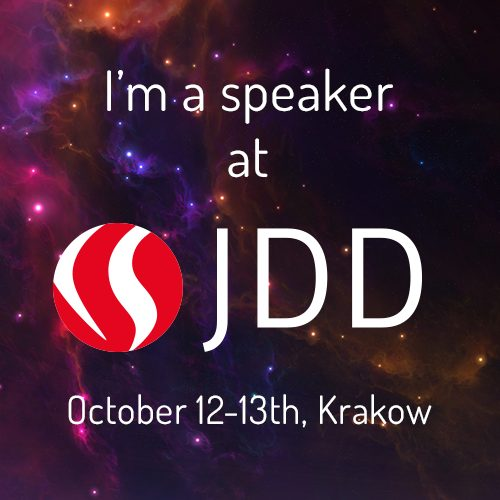

Showing 1011 mistakes developers make during the recruitment process.

Next week I will be speaking at Java Developer’s Day 2015 in Cracow. So if you are planning to change your job in the near future or just want to know what mistakes developers make during the recruitment process, feel invited to my talk (in Polish unfortunately) during the 2nd day of the conference, at 9am.

During my presentation I will tell you about the most frequent and the most ridiculous mistakes during the recruitment process in [SoftwareMill](http://softwaremill.com/) where I am one of the people responsible for hiring talented developers.
Surprisingly these errors quite often could be mapped to mistakes that developers make at work: either when they code or during other activities during work hours. So expect a rather light talk without hardcore coding, with plenty of jokes and funny situations from the real life of a developer-recruiter.

## Plans for the future

But if you have different plans or simply can’t attend JDD, I will be presenting this talk at Poznan JUG in January 2016 and probably also in Łódź and Warsaw in the next few months. So if you want to discuss or ask something, please catch me during these events.

See you at JDD!
