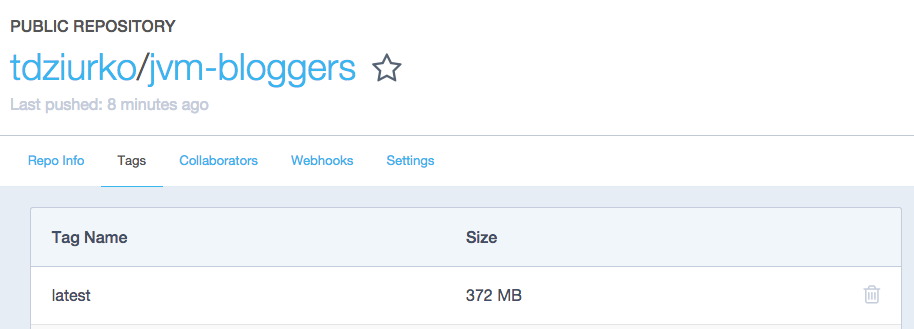

Docker here, Docker there, I see Dockers everywhere.

In this post I will describe the process of migrating a Spring Boot application to Docker. We will start with modifying the build file, then we will create a Dockerfile so it could be run locally. Finally we will publish our image in [DockerHub](https://hub.docker.com/).

## Introduction

A few months ago I started a new personal project called [JVM Bloggers](https://github.com/tdziurko/jvm-bloggers/) with a goal to help Polish programmers with spreading news about their new blog posts. Initially this Spring Boot application was hosted on my local machine, then I migrated it to a free account on [Heroku](https://github.com/tdziurko/jvm-bloggers/).

And for the first weeks I was satisfied: the application didn’t have to be online 24/7 so sleeping for 8 hours per day (limitation of a free Heroku account) was not a big problem, 500 MB memory cap didn’t limit me too. But as JVM Bloggers grew I started to encounter strange issues with memory usage: application started to consume 500-550MB and it was very difficult to find a source of this behaviour. I even left the application running on my local machine with a profiler attached but still didn’t find anything suspicious.

Memory footprint problems became irritating as I had to monitor the application and restart it every 1-2 days and due to Heroku’s nature I could not simply _ssh_ to the server and debug or attach a profiler to the running process. It became clear that if I am going to add more features to JVM Bloggers I have to migrate it to something more flexible – a Linux machine with Docker.

## Docker

Nowadays [Docker](http://docker.com/) is a very popular topic among many developers, especially in projects migrating to a microservices architecture. But the most interesting feature from my problem’s perspective is the ability to create a standardised image of my application and run it in different environments without worrying about differences. One image can be deployed either locally or on almost any Linux machine so with Docker I would be able to test my app locally, deploy it on AWS or somewhere else without much hassle.


## Migration

First we have to add some new dependencies and tasks to our _build.gradle_ script:

```groovy
buildscript {
    // ...
    dependencies {
        // ...
        classpath('se.transmode.gradle:gradle-docker:1.2')
    }
}

// ...

group = 'tdziurko' // this will be my login at DockerHub (more about it later in this post)

task buildDocker(type: Docker, dependsOn: build) {      // this task will build our Docker image
    push = true
    applicationName = jar.baseName
    dockerfile = file('src/main/docker/Dockerfile')
    doFirst {
        copy {
            from jar
            into stageDir
        }
    }
}
```

In line 17 we have specified the location of our Dockerfile so now it is time to create one there.

## Creating Dockerfile

Dockerfile is a configuration file that specifies how to create our Docker image that we can deploy later on.

```dockerfile
FROM java:8
MAINTAINER email@example.com
VOLUME /tmp
EXPOSE 8080

ENV USER_NAME blogger
ENV APP_HOME /home/$USER_NAME/app

RUN useradd -ms /bin/bash $USER_NAME
RUN mkdir $APP_HOME

ADD jvm-bloggers-0.5.0.jar $APP_HOME/jvm-bloggers.jar
RUN chown $USER_NAME $APP_HOME/jvm-bloggers.jar

USER $USER_NAME
WORKDIR $APP_HOME
RUN bash -c 'touch jvm-bloggers.jar'

ENTRYPOINT ["java","-Djava.security.egd=file:/dev/./urandom","-jar","jvm-bloggers.jar"]
```

So let me explain this file step by step:

- **FROM java:8**: our base image, it’s something like _extend_ keyword in Java. Here we want to base on the image with Java 8 installed.
- **VOLUME /tmp**: mounted directory where our application could write something to disk
- **EXPOSE 8080**: port number on which our app will be started, it will be available from the outside of the Docker container
- **ENV USER_NAME blogger**: helper variable with a user name we will use to run our application
- **ENV APP_HOME /home/$USER_NAME/app**: next helper variable with the directory where our app will be located
- **RUN useradd -ms /bin/bash $USER_NAME**: create a user with a name defined in _$USER_NAME_
- **RUN mkdir $APP_HOME**: create app directory
- **ADD jvm-bloggers-0.5.0.jar $APP_HOME/jvm-bloggers.jar**: add fat-jar to our image and put it in _$APP_HOME_
- **RUN chown $USER_NAME $APP_HOME/jvm-bloggers.jar**: all previous commands were executed as _ROOT_ so we need to change the owner of our jar file to _$USER_NAME_. Generally using _ROOT_ in Docker is considered a wrong approach because of security.
- **USER $USER_NAME; WORKDIR $APP_HOME**: change user and working directory to ones we want to use to run our application
- **RUN bash -c ‘touch jvm-bloggers.jar’**: touch our file so it has modification time
- **ENTRYPOINT [“java”,“-Djava.security.egd=file:/dev/./urandom”,“-jar”,“jvm-bloggers.jar”]**: execute our fat-jar (urandom is for Tomcat source of entropy)

## Running Docker image locally

Now we have everything ready to build and launch our Docker image.

```bash
./gradlew clean build buildDocker
```

Response:

```text
:buildDocker FAILED

FAILURE: Build failed with an exception.

* What went wrong:
Execution failed for task ':buildDocker'.
> Docker execution failed
 Command line [docker push tdziurko/jvm-bloggers:latest] returned:
 unauthorized: access to the requested resource is not authorized
```

Task _buildDocker_ failed because you don’t have an account on [DockerHub](https://hub.docker.com/) or you are not logged in there. But if you check local images

```bash
docker images
```

You will see that our image with tag _latest_ is ready to use:

```text
REPOSITORY                  TAG                             IMAGE ID            CREATED             VIRTUAL SIZE
tdziurko/jvm-bloggers       latest                          a09f884c5aa9        11 minutes ago      785.6 MB
```

So we can run it in a docker container with the following command:

```bash
docker run -p 8080:8080 --add-host=database:<your_local_db_host> -e jasypt.encryptor.password="<secretPassword>" -e \
  spring.profiles.active="dev" tdziurko/jvm-bloggers:latest
```

Again, some fragments need more detailed explanation:

- **`--add-host=database:<your_local_db_host>`**: adds address to /etc/hosts in the container, _database_ var should be the address of our database, e.g. _192.168.0.101_
- **`-e jasypt.encryptor.password="<secretPassword>"`**: Jasypt password to decrypt some values from \*.properties files, -e adds it as env variable to the container
- **-e spring.profiles.active=“dev”**: Spring Boot profile. _dev_ is the one used to run the application locally

After a few seconds you should see that our application started and it is running in the Docker container.

## Publishing to DockerHub

Having a Docker image available locally is ok as long as you plan to play with it only on your own computer, but because we are aiming at AWS deployment we need to publish our image to DockerHub, so it is accessible from any Linux machine.

First we need to create an account there (_tdziurko_ in my case) and login using Docker client so we could publish it.

```bash
$ docker login
Username: tdziurko
Password:
Email: tomek@example.com
WARNING: login credentials saved in /Users/tomek/.docker/config.json
Login Succeeded
```

Now we can rebuild our application to push the image to DockerHub:

```bash
./gradlew clean build buildDocker
```

After a few minutes we will see a message _BUILD SUCCESSFUL_ and if you visit your DockerHub public profile page you should see something similar:



which means that our Docker image with application is there waiting for deployment to an AWS EC2 machine. But this is a material for another blog post 🙂

## Summary

In a few steps I have described how to add Docker capabilities to your Java project, how to configure your image and publish it in DockerHub. The whole process is not very complicated and lets us prepare the application for deployment on every Linux machine or server supporting Docker.
