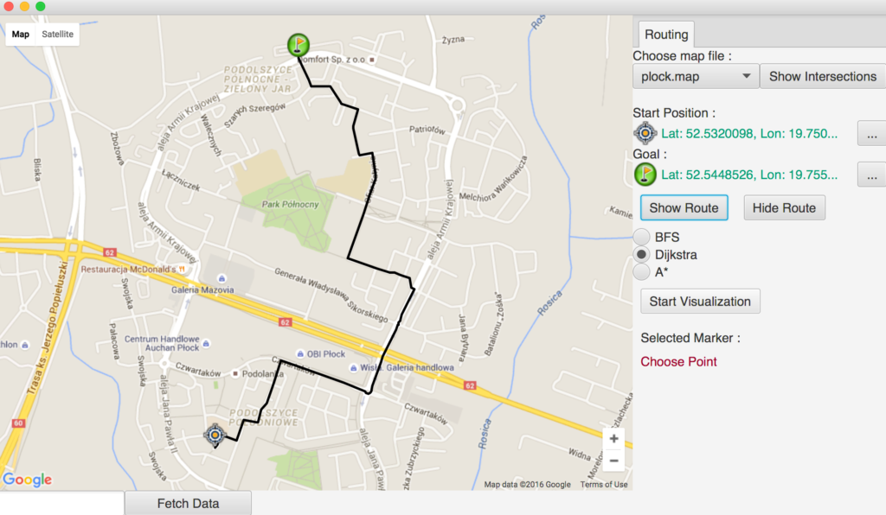

_Short summary after I have finished “Advanced Data Structures in Java” at Coursera_

Online course [“Advanced Data Structures in Java”](https://www.coursera.org/learn/advanced-data-structures/) at Coursera finished last week and I felt that after these cool five weeks it is worth recapping and summarise my impressions.

_image source: [http://lin-ear-th-inking.blogspot.com](http://lin-ear-th-inking.blogspot.com/2013/05/flight-paths-in-jeql-redux.html)_

## Course Content

At the start, do not be misled by the course name. It is not about all advanced data structures which would be a very broad topic, but about graphs, searching algorithms and path calculations.

During the first week we have learnt about data structures that can be used to represent graphs – Adjacency Matrix and Adjacency List – and what are the best use cases to choose each of them. Next we had to create a class hierarchy for a map search engine to be used as a framework during the rest of our assignments. The assignment from this week also required implementing the [Breadth-first Search](https://en.wikipedia.org/wiki/Breadth-first_search) (BFS) algorithm. [DFS](https://en.wikipedia.org/wiki/Depth-first_search) was also covered but we have not coded it in our assignments as it can not be used to find shortest paths.

The third week was about implementing [Dijkstra](https://en.wikipedia.org/wiki/Dijkstra%27s_algorithm) and [A-Star](https://en.wikipedia.org/wiki/A*_search_algorithm) algorithms and how they can be created using BFS as a base. Using BFS as a starting point helped me to understand these algorithms much faster. The fourth week was a theoretical one, the only one without an assignment. So there was no coding but more lectures about [Travelling Salesman Problem](https://en.wikipedia.org/wiki/Travelling_salesman_problem), NP Complete and NP Hard problems and different types of graphs (Eulerian, Hamiltonian).

The final week was the most creative one as we were asked to implement an extension to any of the algorithms we have learnt about. We could extend A* or Dijkstra to use not only distance but also road type or speed limits to find the fastest route or we could try to improve the speed of any of these algorithms or… or we could create completely original extension. I have chosen to implement something I called “Route Calculation Cache”, quote from my submission:

> My extension remembers calculated routes and when another user wants to find a similar route, the extension will retrieve this stored route instead of starting a duplicated and extensive calculation. This will decrease execution time and the user will see routes in a shorter time.

And after that the course ended after five weeks with graphs.

## My impressions

- Sophisticated algorithms are not the thing we use frequently at work so it was very funny feeling to learn again stuff that I was forced to memorize several years ago at university. Obviously now I was more motivated so learning was a more enjoyable process than when I was a young student.
- Test datasets can be obtained for any area using provided application so everyone was able to test A* or Dijkstra using streets from their neighbourhood. You could check if your route to work is optimal or not 😉 Below is a fragment of my home city with a calculated example route:

- Peer reviews. Our solutions for Week3 and (partly) Week5 were reviewed by other developers attending this course. At first I was not convinced that it will bring any value to my learning process, but it appeared that comparing how people from different countries and with different backgrounds designed a class hierarchy to solve the same problem was an interesting experience. I saw approaches similar to mine but also completely different ones but still valid. Another topic is a different approach to documenting code: some developers shared my view and used comments only where it was really, really necessary and tried to write self-explanatory code. But in some people’s solutions I saw as many lines of documentation as lines of code 🙂
- Good peer pressure: because I have advertised this course at [JVM Bloggers](https://github.com/tdziurko/jvm-bloggers/) newsletter I was motivated to graduate 🙂 And the more people I know tweeted that they are joining, the more motivated I was to complete assignments week by week. Discussing the course with developers from my company helped a lot too. Generally this is one of the finest features of online courses: motivating others and getting motivation 🙂

## Wrap up

I am happy that I have enrolled in “Advanced Data Structures in Java”. I have refreshed some long forgotten knowledge about graph structures, learnt a lot too so definitely it was time well spent. Also the satisfaction after successfully finishing a five-week long course is a nice feeling.

And what about you? What are your thoughts about this course or online courses in general?
