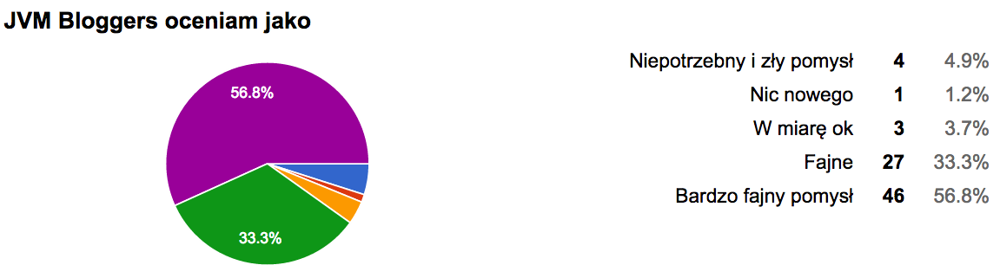
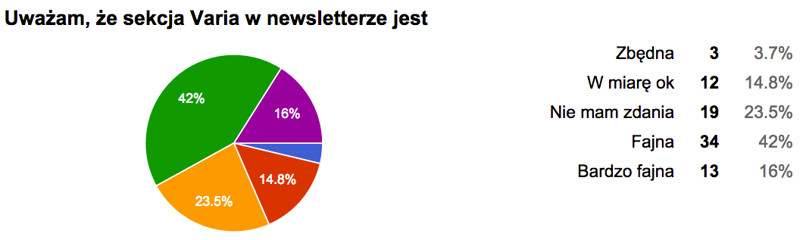
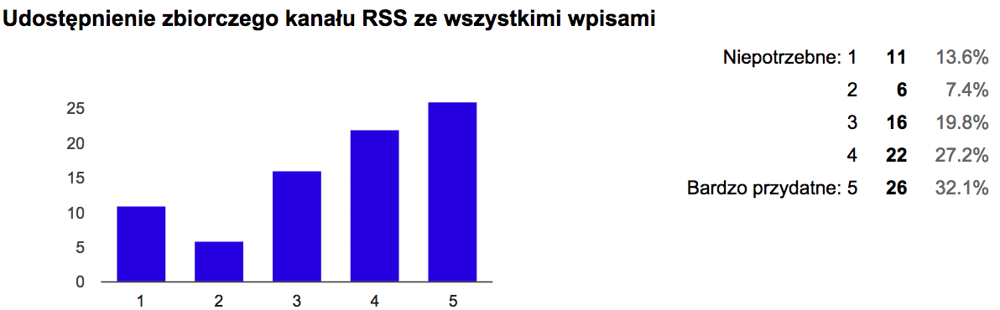
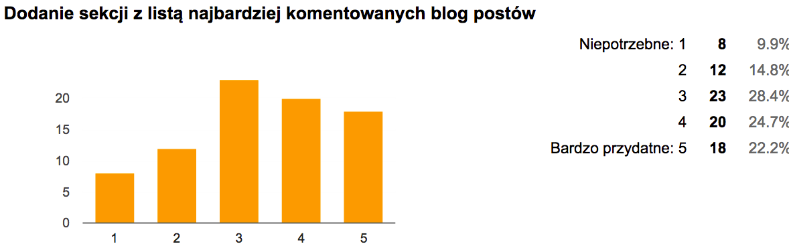
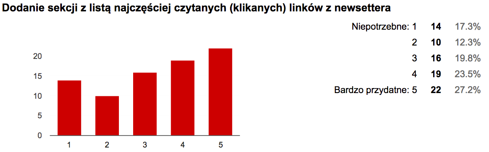
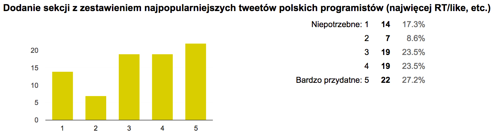
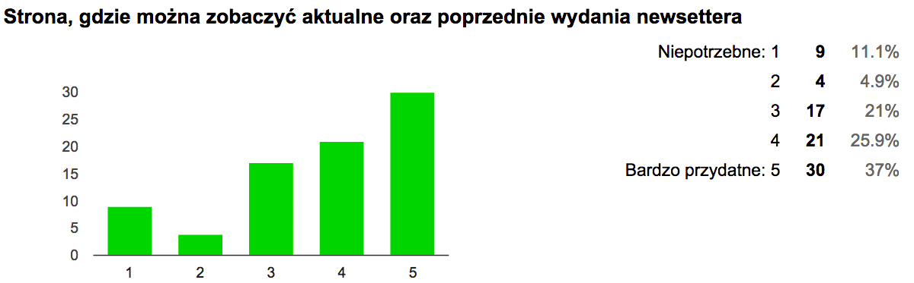
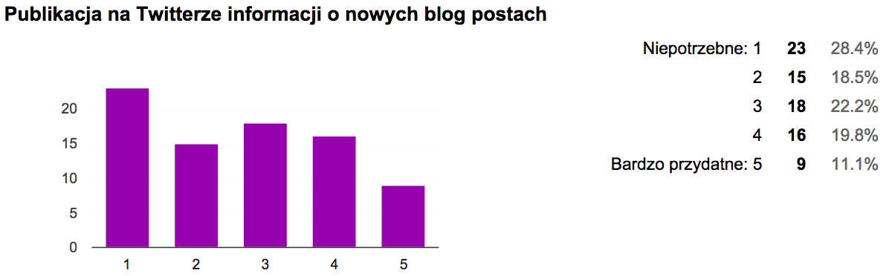
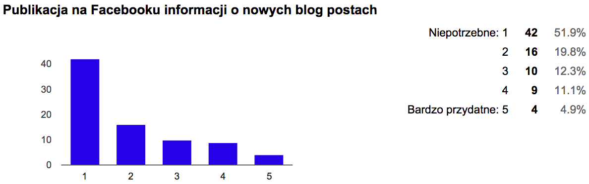
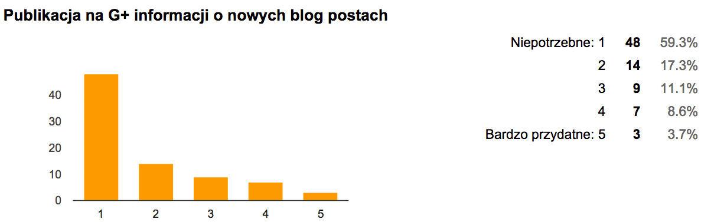

Dwa tygodnie temu przygotowałem ankietę dotyczącą projektu [JVM Bloggers](https://github.com/tdziurko/jvm-bloggers) i poprosiłem o jej wypełnienie programistów z naszej społeczności. Na podstawie odpowiedzi chciałem się dowiedzieć o tym co ludzie sądzą o samym pomyśle, jakie mają odczucia wobec niektórych jego elementów oraz które z planowanych nowych funkcjonalności są dla nich ważne, a które zupełnie zbędne. Liczyłem też na parę ciekawych pomysłów, które pojawią się w odpowiedziach na pytania otwarte. I jak się okazuje, nie zawiodłem się 🙂

{: .tip }
Dear Reader, this post is in my native language as it covers topic that makes sense only for people from Poland. But please feel free to browse my other articles as majority of them are written in English.

Po zebraniu 81 odpowiedzi, przyszła pora na podsumowanie, a ponieważ projekt jest open source to wyniki ankiety też mogą być jawne 🙂

## Odbiór projektu

Zaraz po starcie projektu miałem trochę wątpliwości, że jednak może to jest zupełnie _bes sęsu_, ale patrząc na ogólny odbiór JVM Bloggers, chyba nie jest tak źle, bo **90,1%** osób ocenia projekt jako _Fajny_ lub _Bardzo fajny_.

## Sekcja Varia

Ten element nie był już oceniany tak dobrze (58% osób uważa, że jest _Fajna_ lub _Bardzo fajna_), ale mniej jest również osób, które uważają, że _Varia_ jest zbędna (tylko 3,7%). Dla sporej części Varia _po prostu jest_ 🙂

## Ocena pomysłów na nowe funkcjonalności

Główną częścią ankiety były pytania na temat propozycji nowych funkcjonalności, które z czasem będą dodawane do projektu.

Jak widać dwie najbardziej przydatne rzeczy okiem uczestników ankiety to zbiorczy RSS ze wszystkimi wpisami oraz strona z najnowszym oraz archiwalnymi wydaniami newslettera. Pozostałe rzeczy cieszyły się mniejszą, ale tylko o kilka procent, przychylnością 🙂

## Integracja z Social Media

Trochę mnie to zaskoczyło, ale okazało się, że integracja z Social Media raczej nie jest potrzebna i ludzie wolą otrzymywać zbiorczo informację na maila (lub mieć RSS) niż być bombardowani powiadomieniami na FB/Twitterze/G+.

Wyniki ankiety pokazały też, że Google Plus faktycznie umiera, bo prawie nikt z tego regularnie nie korzysta.

## Pytania otwarte

Jak to najczęściej bywa, najwięcej ciekawych rzeczy pojawiło się w odpowiedziach na pytania otwarte. Poniżej moje komentarze do niektórych wypowiedzi:

- _“projekt miał dotyczyć polskich blogów, a już pojawił się Spring Blog, który chyba wszyscy zainteresowani i tak subskrybują, ida tą drogą za chwile będą jeszcze blogi Oracle, IntelliJ, etc”_

mój komentarz: Blog Springa pojawił się tylko dlatego, że czasami pisze tam Polak ([Marcin Grzejszczak](http://toomuchcoding.com/)), który pracuje w Pivotalu. Pozostałe wpisy nie przechodzą moderacji.

- _“nie wszystkie wpisy techniczne ze śledzonych blogów sa publikowane przez co jesli wiem, że ktoś publikuje ciekawe wpisy techniczne niedotyczące Javy to i tak trzymam jego blog w moich RSSach”_

mój komentarz: blogi programistów nie są moderowane poza przypadkami jakichś mocno politycznych/mało cenzuralnych wpisów. Wszystko poza nimi dotychczas wpadało do newslettera.

- Zbiorczy RSS i strona z aktualnym i poprzednimi wydaniami newslettera – to są dwie rzeczy, które chcemy zaimplementować w pierwszej kolejności. Jest już nawet domena [http://jvm-bloggers.com](http://jvm-bloggers.com/) 🙂
- Kilka osób zaproponowało przeniesienie sekcji “Varia” na dół. Może to jest dobry pomysł, chociaż wtedy mało kto może do niej dotrzeć 🙂 Co o tym sądzicie?
- Głosowanie na fajne posty: to wymaga trochę więcej czasu i kodowania i nie wiem czy naprawdę warto coś takiego robić.

## Podsumowanie

Wszystkie odpowiedzi na pyt. otwarte można zobaczyć pod [tym linkiem](http://bit.ly/1RuX3z5) (można komentować). Ciągle szukamy też osób, które chciałyby pomóc w kodowaniu 🙂 Więcej info oraz kontakt na [GitHubie](https://github.com/tdziurko/jvm-bloggers).

A Wy co sądzicie o wynikach ankiety? Co sądzicie o planowanych funkcjonalnościach? Zachęcam do komentowania tutaj lub w GoogleDocs.
