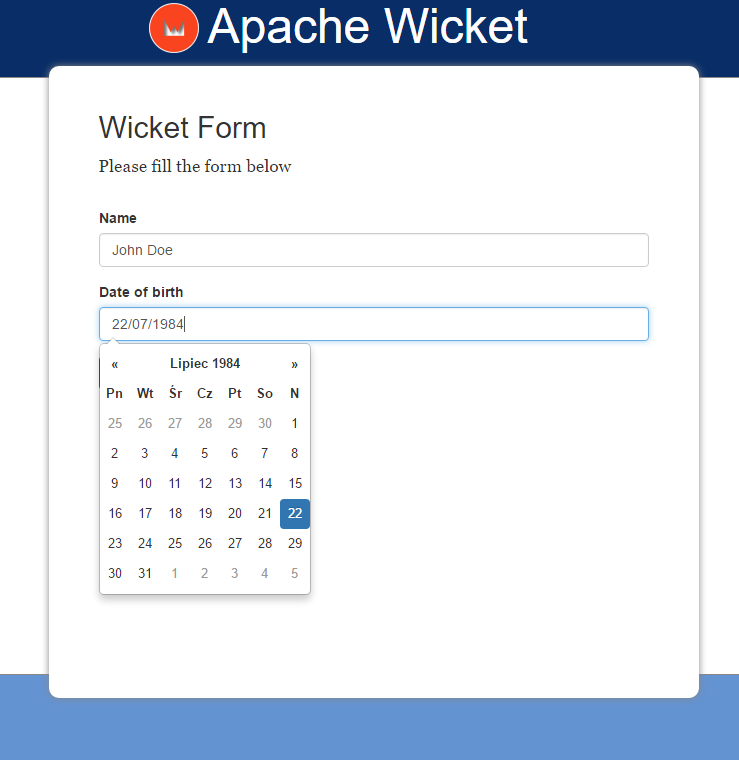

When you add any Wicket component library, e.g. Wicket-Bootstrap to your project, usually it adds some JavaScript and CSS resources to every page or panel. But the problem is that these JS files are added in the `<head>` section of your page while all Internet knowledge says that JS should be placed at the bottom of the page for better performance and faster loading times. In this post I will show how we could configure Wicket to place JS files wherever we want.

## Initial project setup

Let’s start with a simple one-page-one-form Wicket application counting days from the user’s birthday:



It has a dependency on the earlier mentioned Wicket-Bootstrap because we need its DatePicker component:

```xml
<dependency>
  <groupId>de.agilecoders.wicket</groupId>
  <artifactId>wicket-bootstrap-core</artifactId>
  <version>0.10.11</version>
</dependency>
<dependency>
  <groupId>de.agilecoders.wicket</groupId>
  <artifactId>wicket-bootstrap-extensions</artifactId>
  <version>0.10.6</version>
</dependency>
```

Our web page contains a form, one text field and one date picker:

```java
public class HomePage extends WebPage {

	private String name;
	private Date birthDate;

	public HomePage(final PageParameters parameters) {
	  super(parameters);

	  add(new FeedbackPanel("feedbackPanel"));
          Form<HomePage> form = new Form<HomePage>("form", new CompoundPropertyModel<>(this)) {
            @Override
            protected void onSubmit() {
                info(format("Hello %s. It's nice to meet you! You are %d days old!", name, calculateDaysSinceBirthDay(birthDate)));
            }
          };

          form.add(new TextField("name").setRequired(true).setLabel(Model.of("Name")));
          form.add(new DateTextField("birthDate", new DateTextFieldConfig()
                .autoClose(true)
                .withLanguage("pl")
                .withFormat("dd/MM/yyyy"))
            .setLabel(Model.of("Date of birth"))
            .setRequired(true)
          );
          add(form);
      }

      private int calculateDaysSinceBirthDay(Date birthDate) {
        return Days.daysBetween(LocalDate.fromDateFields(birthDate), LocalDate.now()).getDays();
      }

}
```

## Problem

When we run our application we will see that all Bootstrap related JS files are placed in the page header:

```html
<head>
  <!-- ... -->
  <script type="text/javascript" src="./wicket/resource/de.agilecoders.wicket.extensions.markup.html.bootstrap.references.BootstrapDatepickerJsReference/js/datepicker-ver-1484131947646.js"></script>
  <script type="text/javascript" src="./wicket/resource/de.agilecoders.wicket.extensions.markup.html.bootstrap.references.BootstrapDatepickerLangJsReference/js/lang/bootstrap-datepicker.pl-ver-1484131947646.js"></script>
  <script type="text/javascript" id="bootstrap-js" src="./wicket/resource/de.agilecoders.wicket.webjars.request.resource.WebjarsJavaScriptResourceReference/webjars/bootstrap/3.3.7-1/js/bootstrap-ver-1484131946909.js"></script>
  <!-- ... -->
</head>
```

It is not what we wanted, so we need to configure our application to add JS files somewhere at the bottom.

## Solution

First, let’s start with some background. Each time a component wants to add something to the page header (for example using [IHeaderContributor](https://nightlies.apache.org/wicket/apidocs/7.x/org/apache/wicket/markup/html/IHeaderContributor.html)) it creates a new instance of [HeaderItem](https://nightlies.apache.org/wicket/apidocs/7.x/org/apache/wicket/markup/head/HeaderItem.html) object. By default all HeaderItems are rendered in `<head>`, but we could modify this behaviour using [IHeaderResponseDecorator](https://nightlies.apache.org/wicket/apidocs/7.x/org/apache/wicket/markup/html/IHeaderResponseDecorator.html) and [FilteringHeaderResponse](https://nightlies.apache.org/wicket/apidocs/7.x/org/apache/wicket/markup/head/filter/FilteringHeaderResponse.html) to separate HeaderItems into two places to render: header and a defined place in our page body.

First, we should define a place where all JS files should be rendered by adding a `<wicket:container>` element with id:

```html
<!DOCTYPE html>
<html xmlns:wicket="http://wicket.apache.org">
	<body>
		<!-- ... -->
		<wicket:container wicket:id="footer-container"/>

	</body>
</html>
```

and add it to the Page class:

```java
add(new HeaderResponseContainer("footer-container", "footer-container"));
```

The next step is to configure a response decorator and response filter that will direct some items to our _footer-container_ bucket. This should be done in the _init()_ method of our WicketApplication class:

```java
@Override
public void init()
{
    super.init();

    IBootstrapSettings settings = new BootstrapSettings();
    Bootstrap.install(this, settings);

    setHeaderResponseDecorator(new JavaScriptToBucketResponseDecorator("footer-container"));
}
```

Our decorator should use a filter that is already in Wicket core module, a [JavaScriptFilteredIntoFooterHeaderResponse](https://nightlies.apache.org/wicket/apidocs/7.x/org/apache/wicket/markup/head/filter/JavaScriptFilteredIntoFooterHeaderResponse.html) that does exactly what we need:

> A header response that creates two buckets. The header bucket will contain all references to CSS and markup from the `<head>` section from the page. The other bucket will contain all other header items, and you will need to add a HeaderResponseContainer to the footer of your page (typically just before the end body tag) to render those items.

So it will split all our HeaderItems into two buckets, one (default) that will be rendered in the page header and the second rendered where we placed _footer-container_ element. The working version of our decorator looks as presented below:

```java
public class JavaScriptToBucketResponseDecorator implements IHeaderResponseDecorator {
    private String bucketName;

    public JavaScriptToBucketResponseDecorator(String bucketName) {
        this.bucketName = bucketName;
    }

    @Override
    public IHeaderResponse decorate(IHeaderResponse response) {
        return new JavaScriptFilteredIntoFooterHeaderResponse(response, bucketName);
    }
}
```

After that we can rebuild our application and see that all our Bootstrap related JS files are rendered at the bottom of our page, improving performance and the overall experience of our users.
