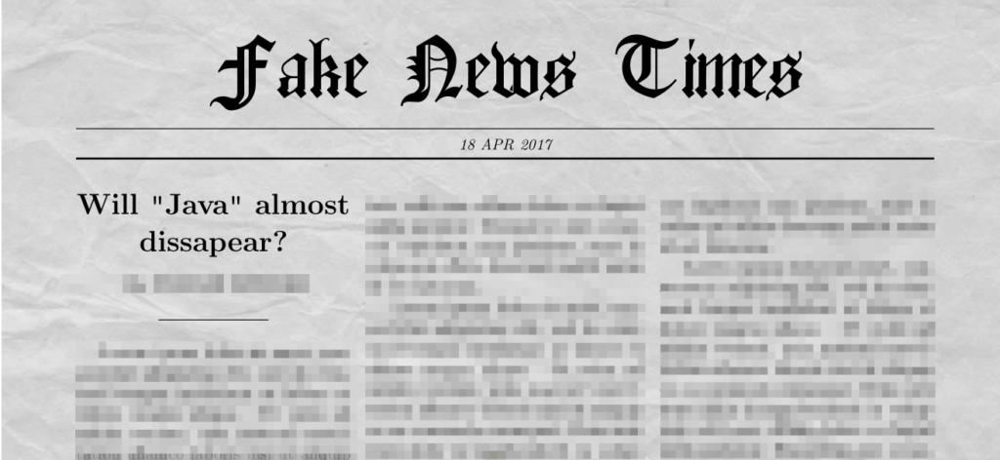
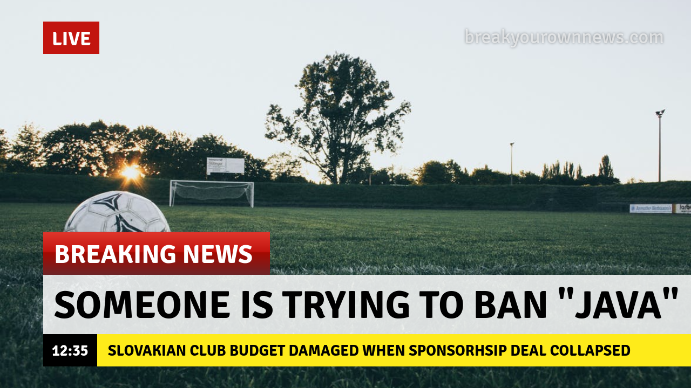

This article is my reaction to the recent Javaslang changing name to Vavr. Please be aware that all content is **completely fictitious** and in many cases ironic.

Reports are coming in from all over the world that some mysterious man in a dark suit contacted various companies strongly suggesting that they should stop using the word “Java” in any form or “bad things might happen”.

By now we were not aware of the number of such incidents but recently many people from different countries and various industries contacted us to share their stories. Below we present some of them:

## Javaslang

One of the core contributors of this library told us anonymously that a few weeks ago the team behind [Javaslang](http://vavr.io/) was approached by a serious-looking man who told them that they should stop using the “Java” word as a part of their library name. He also added that his corporation already has an internal slang called _javaslang_ so nothing with the same name should exist. He even gave one example of one phrase they coined:

> “postponed to the next major release” means “not gonna happen”

## Java, the island

It turns out that not only regular people are approached by these mysterious individuals. Our source in the Indonesian government told us that they also had a very similar situation: a tall man wearing an expensive black suit contacted their delegation during a visit to San Escobar. He urged that nothing could be called Java except their product. When he heard “But we can not change the name of an island, that would force over 140 million of our citizens to change their IDs, addresses and as a result would push our country into chaos” in response, he shouted “But over 3 billion devices use OUR Java! This is much more!”.

## Javart, the company

Individuals, governments, but also companies were on the radar of this unknown and mysterious corporation. A former employee of Javart, a Polish software house, called us to share his relation. During a short session over Skype he claimed that their board was forced to change the name of the company because it contained the “Java” word. He also said that the man in a suit told them that

> Javart name suggests that Java has something in common with the art and that is an obvious lie.

## Jawa, the motorbike

Another company that was contacted by “Java word defenders” was a Czech motorbike manufacturer named [Jawa](http://jawa.eu/). In this case a phrase describing their latest model “The fastest Jawa in the history” was the reason why a suited man appeared in their headquarters near Prague claiming that

> the fastest Java in the history is the incoming Java 9 and they should change their slogan immediately

## Javapolis, the conference

Many of you might have heard about [Devoxx](https://devoxx.com/) conference originating from Belgium, but not many probably know that its original name was Javapolis. But, according to one of the former members of the team behind this event, the name was also affected by external pressure: “Java is a brand known widely in the many countries, many people don’t know English well and

> someone might think that Javapolis is a secret Java Police department in our corporation responsible for hunting for incorrect usages of ‘Java’ word which is of course ridiculous and might show our company in a bad light

## Spartak Myjava, the football club

All presented incidents are strange, but we have kept the best one until the end of this article. Please read a message we have found in our email box:

> I am the chairman of [Spartak Myjava](https://en.wikipedia.org/wiki/Spartak_Myjava), a small football club in Slovakia. We planned to build a new stadium, improve youth facilities but it was very difficult to find a sponsor willing to help us. Then suddenly, a company called Lightbend contacted us willing to pay 1 million Euro each year for becoming our main sponsor. The only thing they wanted is that club should be renamed to **Lightbend MyJava**. At first I was reluctant to do so, but our supporters convinced the board that it would allow us to move to a higher level, maybe even qualify to the Champions League so I agreed. Everything was ready, the contract was waiting only for the signature of the Lightbend CEO, but suddenly everything collapsed. After several calls to find out what had happened, the only thing we were able to get from them (of course off the record) was that another company threatened to sue them if the Lightbend name appeared close to ‘Java’ word.

We leave it without a comment.

## Summary

We have seen many different things but recent attempts to practically ban one word from usage in the many countries, by different companies, places and people are very strange and hard to explain. We think that examples presented above are not the only ones and more will come. We promise to keep you updated. And of course, if you know any other examples, please let us know.

_Image credits: Pexels.com and Wikipedia_
